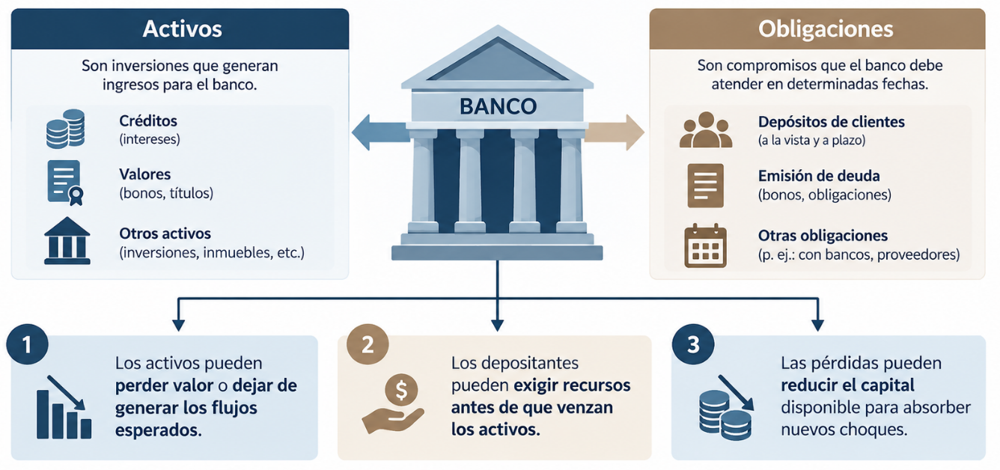
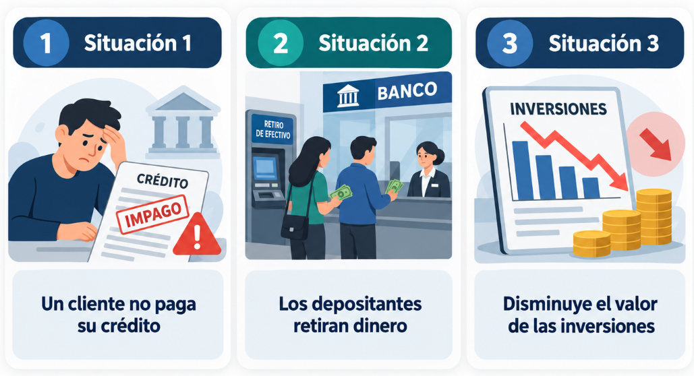

**Pregunta para la clase:**

Por qué existen los Riesgos Financieros?

**¿Cómo funciona financieramente una institución bancaria?**



-   Una institución bancaria mantiene activos que le permiten generar
    ingresos, pero también adquiere obligaciones que debe atender en
    determinadas fechas.

-   Un banco comercial recibe depósitos y otros recursos, que utiliza
    principalmente para conceder préstamos, adquirir inversiones y
    mantener efectivo.

La identidad fundamental es:

$$
\text{Activo} = \text{Pasivo} + \text{Patrimonio}
$$

-   Activo: recursos y derechos económicos que controla la institución;
    por ejemplo, efectivo, créditos e inversiones.

-   Pasivo: obligaciones frente a terceros, como depósitos y
    financiación recibida.

-   Patrimonio: participación residual después de descontar los pasivos
    de los activos.

$$
\text{Patrimonio} = \text{Activo} - \text{Pasivo}
$$

**Ejemplo:**

**Balance general simplificado de un banco**

*Valores en millones de USD.*

| Activos           | Millones USD | Pasivos y patrimonio           | Millones USD |
|:------------------|-------------:|:-------------------------------|-------------:|
| Créditos          |          700 | Depósitos                      |          850 |
| Inversiones       |          200 | Otras obligaciones             |           50 |
| Efectivo          |          100 | Patrimonio                     |          100 |
| **Total activos** |    **1.000** | **Total pasivos y patrimonio** |    **1.000** |

La ecuación contable se cumple:

$$
\boxed{1.000 = 900 + 100}
$$

**Interpretación:** El banco mantiene USD 1.000 millones en activos, de
los cuales USD 900 millones se financian mediante obligaciones y USD 100
millones mediante patrimonio.

Esto significa que por cada USD 100 en activos, USD 90 se financian con
obligaciones y USD 10 con patrimonio.

**¿Qué ocurre si el valor de los activos disminuye o si los depositantes
solicitan sus recursos antes de que el banco pueda recuperar sus
préstamos?**



**Situación 1. Un cliente no paga su crédito**

El banco deja de recibir el dinero previsto y podría reconocer una
pérdida. Esto constituye riesgo de crédito.

**Situación 2. Los depositantes retiran dinero**

El banco debe disponer de recursos líquidos para efectuar pagos, aunque
muchos préstamos todavía no hayan vencido. Esto constituye riesgo de
liquidez.

**Situación 3. Disminuye el valor de las inversiones**

Los cambios en tasas de interés, precios de títulos o cotizaciones
pueden reducir su valor de mercado. Esto constituye riesgo de mercado.

**Ejercicio**

Supongamos que, en el balance anterior, USD 30 millones de la cartera se
pierden de forma definitiva, sin recuperación ni cobertura adicional, y
que la pérdida se reconoce totalmente.

El activo se reduce:

$$
\boxed{\text{Activo}_1 = 1.000 - 30 = 970}
$$

Los pasivos siguen siendo USD 900 millones, por lo que:

$$
\boxed{\text{Patrimonio}_1 = 970 - 900 = 70}
$$

| Variable   | Antes | Después |
|------------|-------|---------|
| Activos    | 1.000 | 970     |
| Pasivos    | 900   | 900     |
| Patrimonio | 100   | 70      |

**Cuanto representa la pérdida?**

La pérdida representa el **3 % de los activos iniciales**, pero consume
el **30 % del patrimonio inicial**.

$$
\frac{30}{100} \times 100 = 30\%
$$

***El patrimonio constituye un recurso de absorción de pérdidas. La
importancia del riesgo no depende exclusivamente de cuánto representa la
pérdida respecto a los activos; también importa cuánto capital puede
absorberla.***

**Diagnóstico**

**Evaluación diagnóstica (0%)**

Responda en 5 minutos, sin calculadora. Sirve para ajustar el ritmo de
la clase.

1.  Un banco tiene activos por 100 y patrimonio por 8. Si pierde 8 en su
    cartera, ¿quién absorbe la pérdida y quién no?

2.  ¿Pesa lo mismo para el capital un préstamo hipotecario que un
    préstamo a una empresa sin calificación?

3.  ¿El BCE puede emitir dólares para atender un retiro masivo de
    depósitos?

4.  Si las tasas de interés suben, ¿qué pasa con el precio de un bono
    que ya está en la cartera?

5.  ¿Quién debería fijar el límite de riesgo de una inversión: el área
    que invierte, el área de riesgos o el directorio?

# Unidad 1. Fundamentos de Riesgo Financiero

La gestión de riesgos financieros constituye un componente esencial de
la estabilidad de las instituciones bancarias y de los bancos centrales.
Sin embargo, los riesgos, los instrumentos de mitigación y los criterios
de evaluación cambian según la naturaleza y el mandato de cada
institución.

## 1.2 Basilea

-   Los bancos utilizan fondos de depositantes y acreedores para
    adquirir activos cuyo valor y recuperación no están garantizados.

-   Si una entidad asume exposiciones excesivas sin capital suficiente,
    una pérdida importante puede comprometer su continuidad. Cuando el
    problema afecta a varias instituciones, existe además un riesgo para
    la estabilidad del sistema financiero.

-   Por esa razón, los supervisores establecen normas prudenciales que
    buscan mejorar la capacidad de los bancos para absorber pérdidas y
    gestionar sus exposiciones.

-   El Comité de Supervisión Bancaria de Basilea desarrolla estándares
    internacionales que las jurisdicciones incorporan a sus propios
    marcos regulatorios.

**Evolución de los acuerdos**

| Acuerdo | Año de referencia | Principal contribución |
|----|----|----|
| Basilea I | 1988 | Introduce un estándar internacional de suficiencia de capital asociado principalmente al riesgo crediticio |
| Basilea II | 2004 | Desarrolla los tres pilares de supervisión y amplía la sensibilidad al riesgo |
| Basilea III | Desde 2010 | Refuerza calidad y cantidad del capital, colchones, apalancamiento, liquidez y medición de riesgos |

El marco de Basilea busca fortalecer la resiliencia de las instituciones
bancarias mediante estándares de

-   Capital

-   Liquidez

-   Gestión de riesgos

-   Supervisión.

Los tres pilares de Basilea II

-   **Pilar 1.** Requisitos mínimos de capital: determina recursos
    regulatorios para cubrir exposiciones de riesgo.

-   **Pilar 2.** Revisión supervisora: permite evaluar riesgos, procesos
    de gestión y suficiencia de capital más allá de los cálculos
    mínimos.

-   **Pilar 3.** Disciplina de mercado: promueve divulgación de
    información relevante para que los participantes comprendan el
    perfil financiero de las entidades.

-   Basilea III mantiene y refuerza este marco.

***"Los Activos de un Banco tienen el mismo Riesgo"***

Consideremos dos exposiciones hipotéticas:

1.  Un instrumento de alta calidad crediticia, con elevada liquidez y
    vencimiento corto.

2.  Un préstamo a un cliente con elevada probabilidad de incumplimiento.

***Aunque ambos tengan un valor nominal de USD 100 millones, su
exposición al riesgo puede ser muy diferente.***

| Activo                        | Valor       | Riesgo |
|-------------------------------|-------------|--------|
| Bonos del Tesoro              | 100.000.000 | Bajo   |
| Prestamó (Cartera de Crédito) | 100.000.000 | Alto   |

-   Los instrumentos de alta calidad crediticia se mantienen líquidos y
    seguros.

-   Los préstamos riesgosos requieren provisiones y pueden deteriorar el
    balance si el cliente incumple.

**Activos ponderados por riesgo (RWA)**

Por ello, las normas prudenciales contemplan activos ponderados por
riesgo, conocidos como **RWA (Risk-Weighted Assets)**.

Para un ejemplo simplificado:

$$ RWA = \sum_{i=1}^{n} E_i w_i $$

Donde:

-   $E_i$ es la exposición (valor nominal del activo).
-   $w_i$ es su ponderación regulatoria correspondiente.

En un cálculo real también intervienen metodologías para distintos tipos
de riesgo, ajustes y tratamientos específicos.

**Ejercicio**

| Exposición | Monto (USD M) | Ponderación supuesta | RWA |
|------------|---------------|----------------------|-----|
| A          | 100           |                      |     |
| B          | 200           |                      |     |
| C          | 300           |                      |     |
| **Total**  | **600**       |                      |     |

**Fórmula aplicada**

$$ RWA = 100(0) + 200(0.5) + 300(1) $$

$$ \boxed{RWA = 400} $$

| Exposición | Monto (USD M) | Ponderación supuesta | RWA     |
|------------|---------------|----------------------|---------|
| A          | 100           | 0%                   | 0       |
| B          | 200           | 50%                  | 100     |
| C          | 300           | 100%                 | 300     |
| **Total**  | **600**       |                      | **400** |

**Interpretación**

El valor contable de las exposiciones es USD 600 millones, mientras que
su importe ponderado por riesgo es USD 400 millones.

La diferencia se debe a que el denominador regulatorio incorpora el
tratamiento de riesgo aplicado a cada exposición, no únicamente sus
montos nominales.

👉 **En resumen:** la exposición es el monto bruto que el banco tiene
invertido o prestado, mientras que el RWA refleja cuánto de ese monto
realmente cuenta como riesgo regulatorio.

## ¿Qué es el capital regulatorio?

No todo el patrimonio contable de un banco es necesariamente admisible
como **capital regulatorio**.\
Los marcos prudenciales clasifican los instrumentos de capital según su
capacidad de absorber pérdidas, permanencia y otras condiciones.

En términos generales:

-   **CET1 (Common Equity Tier 1):** capital ordinario de mayor calidad
    regulatoria.\
-   **Tier 1:** CET1 más otros instrumentos admisibles de nivel 1.\
-   **Capital total:** Tier 1 más capital admisible de nivel 2, sujeto a
    las reglas correspondientes.

**📊 Estándar internacional de Basilea III**

| Indicador               | Mínimo sobre RWA |
|-------------------------|------------------|
| CET1                    | 4.5%             |
| Tier 1                  | 6.0%             |
| Capital total           | 8.0%             |
| Colchón de conservación | +2.5% CET1       |

**📌 Ejemplo aplicado con balance simplificado (Banco en Ecuador)**

**Activo**\
- Caja y Bancos: 50 M\
- Inversiones en Bonos del Estado: 100 M\
- Cartera de Créditos Comerciales: 200 M\
- Cartera de Créditos Hipotecarios: 150 M\
- Activos Intangibles (software, goodwill): 10 M

**Pasivo**\
- Depósitos a la vista: 250 M\
- Depósitos a plazo: 150 M\
- Obligaciones con el exterior: 50 M

**Patrimonio contable**\
- Capital social ordinario: 20 M\
- Reservas legales y acumuladas: 15 M\
- Acciones preferentes: 5 M\
- Deuda subordinada: 10 M\
- Activos intangibles (deducción regulatoria): –10 M

**🧮 Cálculo regulatorio**

$$ CET1 = (20 + 15) - 10 = 25\ \text{M} $$

$$ Tier\ 1 = CET1 + Acciones\ preferentes = 25 + 5 = 30\ \text{M} $$

$$ Capital\ Total = Tier\ 1 + Deuda\ subordinada = 30 + 10 = 40\ \text{M} $$

**📊 Supongamos RWA = 400 M**

| Indicador     | Capital (M USD) | Fórmula              | Ratio calculado |
|---------------|-----------------|----------------------|-----------------|
| CET1          | 25              | $$ \frac{25}{400} $$ | 6.25%           |
| Tier 1        | 30              | $$ \frac{30}{400} $$ | 7.5%            |
| Capital Total | 40              | $$ \frac{40}{400} $$ | 10%             |

**🧩 Colchón de conservación**

El estándar de Basilea III exige un **colchón adicional de 2.5% en
CET1**.\
Esto significa que el mínimo efectivo de CET1 no es 4.5%, sino:

$$ CET1\ mínimo\ efectivo = 4.5\% + 2.5\% = 7.0\% $$

Comparando:

-   CET1 ratio calculado: **6.25%**\
-   CET1 mínimo efectivo: **7.0%**

👉 El banco cumple el mínimo regulatorio de 4.5%, pero no alcanza el
colchón de conservación.\
En la práctica, esto implicaría restricciones en distribución de
utilidades (dividendos, bonos, etc.) hasta que el banco acumule más
capital.

**✅ Interpretación didáctica**

-   El capital regulatorio es la parte del patrimonio que realmente
    cuenta para absorber pérdidas.\

-   Los mínimos de Basilea III aseguran que los bancos mantengan
    colchones suficientes frente a riesgos.\

-   El colchón de conservación (+2.5% CET1) eleva el estándar efectivo y
    obliga a los bancos a mantener capital adicional en épocas normales.

**Qué es la CAR?**

Una vez que conocemos el capital regulatorio y los RWA, podemos
introducir el coeficiente de adecuación de capital.

$$ CAR = \frac{Capital\ regulatorio\ total}{RWA} \times 100 $$\*\*Ejercicio

:   suficiencia de capital\*\*

Supongamos que el banco tiene:

-   Capital regulatorio admisible: USD 60 millones.

-   RWA: USD 400 millones.

$$ CAR = \frac{60}{400} \times 100 = 15\% $$

**Interpretación:** por cada USD 100 de activos ponderados por riesgo,
el banco mantiene USD 15 de capital regulatorio.

**¿Qué pasa si los RWA aumentan a USD 500 millones sin que cambie el
capital?**

$$ CAR_1 = \frac{60}{500} \times 100 = 12\% $$

👉 El CAR disminuye del 15% al 12%. Esto demuestra que el coeficiente
puede deteriorarse porque aumentan las exposiciones ponderadas, incluso
sin que el capital nominal disminuya.

**Pregunta para los estudiantes:**

¿podemos afirmar que una institución con patrimonio/activos de 20% es
más solvente que un banco con CAR de 12%?\
**Respuesta:**

No. Los indicadores tienen diferentes numeradores, denominadores y
objetivos.

## 1.2 ISO 31000

**¿Qué significa gestionar riesgos?**

Identificar un riesgo no es suficiente. Una institución debe comprender
sus causas, estimar sus consecuencias, evaluar si la exposición resulta
aceptable, establecer controles y verificar si estos funcionan.

Por ejemplo, reconocer que una inversión puede perder valor no significa
que el riesgo esté administrado.

Para gestionarlo es necesario determinar qué puede ocasionar la pérdida,
cómo se mide, quién la supervisa, qué límites existen y qué medidas se
adoptarán si la exposición supera lo permitido.

**¿Qué establece ISO 31000?**

La norma ISO 31000:2018 proporciona principios, un marco y un proceso de
gestión de riesgos. Se puede adaptar a diferentes organizaciones y tipos
de exposición.

No establece un requisito específico de capital financiero y no
constituye un sistema de certificación institucional. La edición de 2018
continúa vigente, aunque está en revisión para una futura edición.

### Riesgo inherente y residual

El riesgo inherente es la exposición que se evalúa antes de considerar
los efectos de los controles pertinentes.

El riesgo residual es el que permanece una vez considerados dichos
controles.

Una técnica cualitativa frecuente consiste en asignar niveles ordinales
de probabilidad e impacto.

$$ R = P \times I $$

Este producto constituye una puntuación convencional de matriz. No debe
interpretarse como una probabilidad estadística ni como una pérdida
monetaria.

Se utiliza una escala didáctica de 1 a 5:

| Variable                     | Antes de controles | Después de controles |
|------------------------------|--------------------|----------------------|
| Probabilidad, escala ordinal | 4                  | 2                    |
| Impacto, escala ordinal      | 5                  | 4                    |
| Puntuación                   | 20                 | 8                    |

$$ R_{inherente} = 4 \times 5 = 20 $$
$$ R_{residual} = 2 \times 4 = 8 $$

Los controles considerados son:

-   Límites de exposición por contraparte.

-   Evaluación periódica de calidad crediticia.

-   Diversificación de depósitos e inversiones.

-   Procedimientos de escalamiento cuando se superan límites.

**Interpretación:**

La matriz clasifica el riesgo residual por debajo del inherente. No
podemos afirmar que las pérdidas esperadas se redujeron exactamente 60%,
porque las puntuaciones no representan pérdidas cuantitativas.

### Pérdida esperada (Expected Loss)

Para diferenciar una matriz cualitativa de un modelo financiero,
introduciremos brevemente:

$$ EL = PD \times LGD \times EAD $$

Donde:

-   $(PD)$: probabilidad de incumplimiento.

-   $(LGD)$: proporción de exposición que se perdería condicionada al
    incumplimiento.

-   $(EAD)$: exposición al momento del incumplimiento.

**Ejemplo:**

$$ EL = 0,02 \times 0,40 \times 10.000.000 $$ $$ EL = USD\ 80.000 $$

La pérdida esperada calculada es USD 80.000 durante el horizonte al que
corresponden los parámetros, bajo los supuestos simplificados.

No significa que ocurrirá necesariamente esa pérdida; expresa el valor
esperado del modelo.

En la Unidad 2 profundizaremos en estimación de PD, LGD, EAD,
provisiones y riesgo de contraparte.

> El BCE necesita mantener activos de alta liquidez para atender
> obligaciones, pero parte de las inversiones ofrece mayor rendimiento a
> plazos largos.

Los participantes deben identificar dos riesgos, una posible causa, un
indicador para medir cada riesgo y una medida de control.

Solución orientativa:

| Riesgo | Causa | Indicador | Control |
|----|----|----|----|
| Liquidez | Descalce entre vencimientos y obligaciones | Brecha acumulada por plazo | Mantener recursos realizables y límites de liquidez |
| Mercado | Variación de tasas internacionales | Duración, DV01 o sensibilidad | Límites de duración y seguimiento de mercado |

Conclusión: una decisión financiera puede mejorar la rentabilidad
esperada y, simultáneamente, aumentar la exposición al riesgo.

## 1.3 Solvencia

**Qué es la solvencia?**

La solvencia se relaciona con la capacidad patrimonial y financiera de
una institución para absorber pérdidas y sostener sus obligaciones.

La liquidez, en cambio, se refiere a la capacidad de disponer de
recursos oportunamente para cumplir pagos.

| Pregunta | Solvencia | Liquidez |
|----|----|----|
| ¿Cuál es el problema? | Pérdidas que deterioran la posición patrimonial | Incapacidad de atender pagos en el momento requerido |
| ¿Qué se analiza? | Activos, pasivos, capital o patrimonio | Flujos, vencimientos y disponibilidad de recursos |
| ¿Puede existir con patrimonio positivo? | El deterioro patrimonial puede preceder a la insolvencia | Sí, puede haber problemas de liquidez con patrimonio positivo |

**Ejemplo conceptual**

Un banco tiene USD 1.000 millones en activos, USD 900 millones en
pasivos y USD 100 millones en patrimonio.

Sus activos incluyen préstamos de largo plazo, pero mañana debe pagar
USD 200 millones.

Si solo tiene USD 50 millones líquidos y no dispone de otras fuentes de
fondos oportunas, puede experimentar un problema de liquidez, aunque
mantenga patrimonio positivo.

Esta distinción será fundamental para el análisis del BCE.

**Solvencia en un banco**

En la banca comercial no basta con conocer el patrimonio contable.

La suficiencia regulatoria del capital depende de la definición de
capital admisible, las deducciones pertinentes, la ponderación de
exposiciones y otros requisitos prudenciales aplicables.

Por eso, para la banca utilizaremos dos indicadores distintos:

$$ \text{Patrimonio/Activo} = \frac{Patrimonio}{Activo} \times 100 $$

$$ CAR = \frac{Capital\ regulatorio}{RWA} \times 100 $$

El primero describe una proporción contable. El segundo evalúa
suficiencia de capital conforme a un marco prudencial.

**Ejemplo BCE 2025:**

Ahora utilizaremos los estados financieros auditados del Banco Central
del Ecuador, al 31 de diciembre de 2025.

Importes en millones de dólares, redondeados.

| Concepto   | 2024      | 2025      |
|------------|-----------|-----------|
| Activos    | 15.102,18 | 17.841,27 |
| Pasivos    | 12.284,99 | 13.507,29 |
| Patrimonio | 2.817,19  | 4.333,98  |

Fuente: BCE, Estados Financieros Auditados 2025, estado de situación
financiera comparativo.

**Ejercicio**

$$ \frac{4.333,98}{17.841,27} \times 100 = 24,29\% $$

**¿Qué significa?**

Por cada USD 100 de activos registrados, aproximadamente USD 24,29
corresponden al patrimonio contable.

No significa que el BCE mantenga USD 24,29 de efectivo disponible por
cada USD 100 de activos, ni que ese porcentaje sea un CAR bancario.

## Ejemplo: Patrimonio sobre Activos del BCE

Para 2024:

$$ PA_{2024} = \frac{2.817,19}{15.102,18} \times 100 \approx 18,65\% $$

Para 2025:

$$ PA_{2025} = \frac{4.333,98}{17.841,27} \times 100 \approx 24,29\% $$

El indicador aumenta aproximadamente:

$$ 24,29 - 18,65 = 5,64\ \text{puntos porcentuales} $$

**Interpretación:** la proporción patrimonial contable es mayor en 2025.
Sin embargo, para determinar sus causas necesitamos examinar la
evolución de resultados, ajustes de valoración y movimientos
patrimoniales.

Un indicador mayor no demuestra por sí solo que todos los riesgos
financieros hayan disminuido.

### Pregunta de discusión

¿Por qué no podemos comparar el CAR de Banco Pichincha con el cociente
patrimonio/activos del BCE?

## 1.4 Riesgo Financiero

**¿Qué cambia cuando un país no emite la moneda que utiliza?**

En Ecuador, el dólar estadounidense es la moneda de curso legal. El BCE
no emite billetes de dólares y no controla directamente las decisiones
de la Reserva Federal de Estados Unidos.

La excepción relevante es que Ecuador mantiene atribuciones legales
sobre moneda metálica fraccionaria nacional. Por tanto, la formulación
técnicamente correcta no es «el BCE no puede emitir absolutamente
ninguna moneda», sino que no puede emitir los billetes de dólares
estadounidenses que circulan en la economía.

Esto introduce varias particularidades.

| Dimensión | Consecuencia en Ecuador |
|----|----|
| Emisión monetaria | No se pueden crear billetes USD mediante emisión propia |
| Liquidez | Depende de los recursos y mecanismos disponibles legalmente |
| Tasas internacionales | Las condiciones de financiamiento e inversión en USD están influidas por los mercados internacionales |
| Reservas internacionales | Tienen particular relevancia para la liquidez externa y el funcionamiento de la dolarización |
| Riesgo cambiario | No existe riesgo de depreciación de una moneda nacional propia frente al USD, pero sí exposiciones a otras divisas |
| Rentabilidad de reservas | Debe analizarse junto con seguridad y liquidez, no como objetivo único |

No debemos concluir que el BCE carece de funciones monetarias o de
mecanismos para administrar liquidez. Lo correcto es identificar las
herramientas efectivamente previstas en su marco jurídico.

**Riesgo de crédito**

Ocurre cuando un deudor o contraparte no cumple sus obligaciones
financieras.

En un banco comercial, una exposición típica es un préstamo. En el BCE,
este riesgo puede relacionarse con determinadas inversiones, depósitos,
operaciones y contrapartes.

La diferencia está en la naturaleza de las posiciones y en el mandato
institucional.

**Ejemplo**

Un banco mantiene un crédito de USD 10 millones. El deudor incumple y,
después de las recuperaciones, se pierde el 30% de la exposición.

$$ Pérdida = 10.000.000 (0,30) $$

$$ \boxed{Pérdida = USD\ 3.000.000} $$

Es una pérdida realizada o estimada bajo el escenario descrito, no una
pérdida esperada probabilística.

Para calcular esta última necesitaríamos incorporar la probabilidad de
incumplimiento y las demás variables del modelo.

**Riesgo de Liquidez**

Una institución enfrenta riesgo de liquidez cuando puede tener
dificultades para obtener los recursos necesarios a tiempo, o necesita
liquidar activos en condiciones desfavorables.

En Ecuador, este tema es especialmente relevante porque el BCE no puede
recurrir a la emisión autónoma de dólares estadounidenses.

**Caso real BCE: vencimientos de diciembre de 2025**

El informe auditado presenta las siguientes posiciones financieras,
expresadas en millones de dólares.

| Vencimiento   | Activos  | Pasivos   |
|---------------|----------|-----------|
| Hasta 30 días | 8.448,36 | 12.456,64 |
| 31–90 días    | 1.332,70 | 0         |
| 91–180 días   | 703,02   | 0         |
| 181–360 días  | 345,75   | 0         |
| Más de un año | 6.838,57 | 1.050,65  |

**Ejercicio:** Brecha de Liquidez

$$ Brecha_t = Activos_t - Pasivos_t $$

Para la banda de hasta 30 días:

$$ Brecha_{30d} = 8.448,36 - 12.456,64 = -4.008,29\ millones $$

**Interpretación:** las obligaciones clasificadas en esa banda superan a
los activos registrados en el mismo intervalo.

Esto representa una asimetría de vencimientos; no constituye por sí solo
evidencia de incumplimiento o insolvencia. La capacidad real de atención
de pagos también depende de la liquidez inmediata, las entradas y
salidas efectivas y las fuentes de recursos disponibles.

**El concepto de cobertura**

El informe auditado también presenta que, a diciembre de 2025, los
activos con disponibilidad o vencimiento a un día cubrían el 42% de los
pasivos exigibles a ese plazo.

Este porcentaje mide una relación específica de liquidez, no una
cobertura total de las obligaciones por reservas internacionales.

La enseñanza consiste en reconocer que el resultado de un indicador
depende de sus definiciones, su plazo y los activos que incluye.

**Riesgo de Mercado**

Surge cuando los precios, rendimientos o cotizaciones de mercado
modifican el valor de los activos y pasivos expuestos.

En esta unidad introduciremos tres factores relevantes:

-   Tasas de interés.

-   Cotizaciones de divisas.

-   Precio del oro.

En la Unidad 4 desarrollaremos duración, convexidad, volatilidad, VaR y
Expected Shortfall/CVaR.

**Ejemplo: tasas de interés y bonos**

Para un instrumento de renta fija, el aumento de los rendimientos de
mercado suele asociarse con una caída de su precio.

Una aproximación es:

**Riesgo de tipo de cambio y dolarización**

Una confusión frecuente es afirmar que en Ecuador no existe riesgo
cambiario porque su moneda de uso es el dólar.\
Eso es incorrecto. El BCE puede mantener activos y obligaciones
denominados en distintas monedas o unidades de cuenta, cuya valoración
en USD varía con las cotizaciones internacionales.

**Ejercicio ilustrativo:**

\
Supongamos que una institución posee **EUR 10 millones**.

Cotización inicial:

$$ 1\ EUR = 1,10\ USD $$

Valor inicial:

$$ V_0 = 10.000.000 (1,10) = USD\ 11.000.000 $$

Cotización posterior:

$$ 1\ EUR = 1,05\ USD $$

Valor posterior:

$$ V_1 = 10.000.000 (1,05) = USD\ 10.500.000 $$

Variación:

$$ \Delta V = 10.500.000 - 11.000.000 $$

$$ \boxed{\Delta V = -USD\ 500.000} $$

La posición pierde valor expresado en USD, aunque el número de euros
permanezca constante.

**Conclusión:** la dolarización elimina la emisión propia de una moneda
nacional distinta al dólar como instrumento convencional, pero **no
elimina las exposiciones cambiarias internacionales**.

## 1.5 Gobierno Financiero

**¿Por qué no basta con medir los riesgos?**

Supongamos que una unidad técnica calcula que cierta inversión presenta
una elevada exposición a pérdidas.

La información, por sí sola, no garantiza que el riesgo esté bajo
control.

Es necesario responder:

-   ¿Quién autorizó la inversión?

-   ¿Qué límite se aprobó?

-   ¿Quién vigila su cumplimiento?

-   ¿Quién decide cuando se supera el límite?

-   ¿Quién evalúa de manera independiente los controles?

Estas preguntas corresponden al gobierno financiero y al gobierno de
riesgos.

**Marco Legal Ecuatoriano**

Para esta parte de la clase utilizaremos el marco normativo vigente y
distinguiremos las funciones de sus diferentes disposiciones.

| Instrumento | Aspecto relevante para la clase |
|----|----|
| Constitución, art. 302 | Objetivos de las políticas monetaria, crediticia, cambiaria y financiera |
| Constitución, art. 303 | Formulación e instrumentación de políticas y papel del BCE |
| Código Orgánico Monetario y Financiero | Mandato, funciones, operaciones y régimen del BCE |
| Reformas de 2021 | Marco relacionado con la defensa de la dolarización, autonomía y estructura financiera |
| Reforma de octubre de 2025 | Organización actualizada de la Junta y gobierno institucional |
| Resolución JPRFM-2025-011-M | Marco de administración integral de riesgos |
| Estatuto y normativa interna vigentes | Funciones, responsabilidades y procedimientos específicos |

Según los estados financieros auditados de 2025, la reforma publicada el
13 de octubre de 2025 estableció la Junta de Política y Regulación
Financiera y Monetaria como máximo órgano de gobierno del BCE.

**Enfoque de tres líneas**


**Apetito, tolerancia y límites de riesgo**

Estos conceptos están relacionados, pero no significan lo mismo.

**Apetito de riesgo:** nivel y tipo de riesgo que una organización está
dispuesta a asumir para alcanzar sus objetivos.

**Tolerancia al riesgo:** variación o desviación aceptable dentro de
determinados criterios.

**Límites de riesgo:** restricciones operativas cuantificadas para
controlar exposiciones específicas.

Una cartera hipotética mantiene:

$$ Duración_{observada} = 5,5\ \text{años} $$

Su límite interno supuesto es:

$$ Duración_{límite} = 4\ \text{años} $$

**Exceso:**

$$ 5,5 - 4 = 1,5\ \text{años} $$

**Exceso relativo:**

$$ \frac{1,5}{4} \times 100 = 37,5\% $$

**Resultado:** la duración supera en **37,5%** el límite supuesto.

**¿Qué debe hacer la institución?**

No basta con indicar que el portafolio está generando más rendimiento.
Se debe establecer la causa del exceso, medir sus consecuencias y
activar los procedimientos de comunicación, corrección o autorización
previstos.

La unidad que ejecuta las inversiones no debería otorgarse
unilateralmente una excepción a sus propios límites si carece de
competencia formal para hacerlo.

# Unidad 2. Riesgo de Crédito

## 2.1 Evaluación crediticia

## 2.2 Incumplimiento

## 2.3 Exposición

## 2.4 Provisiones

## 2.5 Indicadores Financieros

# Unidad 3. Riesgo de Liquidez

## 3.1 Liquidez Institucional

## 3.2 Flujos financieros

## 3.3 Brechas de liquidez

## 3.4 Indicadores

## 3.5 Stress testing

# Unidad 4. Riesgo de Mercado

## 4.1 Tasas de Interés

## 4.2 Tipo de cambio

## 4.3 Volatilidad

## 4.4 Sensibilidad

## 4.5 VaR

# Unidad 5. Perfil Integral de Riesgo Financiero

## 5.1 Capital económico

## 5.2 Apetito de Riesgo

## 5.3 Consolidación financiera

## 5.4 Evaluación integral

## 5.5 Reportes ejecutivos

Quarto enables you to weave together content and executable code into a
finished document. To learn more about Quarto see <https://quarto.org>.

```{r}
1 + 1
```
