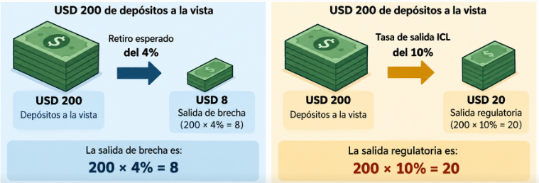

**Pregunta para la clase:**

Por qué existen los Riesgos Financieros?

**¿Cómo funciona financieramente una institución bancaria?**


-   Una institución bancaria mantiene activos que le permiten generar
    ingresos, pero también adquiere obligaciones que debe atender en
    determinadas fechas.

-   Un banco comercial recibe depósitos y otros recursos, que utiliza
    principalmente para conceder préstamos, adquirir inversiones y
    mantener efectivo.

La identidad fundamental es:

$$
\text{Activo} = \text{Pasivo} + \text{Patrimonio}
$$

-   Activo: recursos y derechos económicos que controla la institución;
    por ejemplo, efectivo, créditos e inversiones.

-   Pasivo: obligaciones frente a terceros, como depósitos y
    financiación recibida.

-   Patrimonio: participación residual después de descontar los pasivos
    de los activos.

$$
\text{Patrimonio} = \text{Activo} - \text{Pasivo}
$$

**Ejemplo:**

**Balance general simplificado de un banco**

*Valores en millones de USD.*

| Activos           | Millones USD | Pasivos y patrimonio           | Millones USD |
|:---------------|---------------:|:-------------------------|---------------:|
| Créditos          |          700 | Depósitos                      |          850 |
| Inversiones       |          200 | Otras obligaciones             |           50 |
| Efectivo          |          100 | Patrimonio                     |          100 |
| **Total activos** |    **1.000** | **Total pasivos y patrimonio** |    **1.000** |

La ecuación contable se cumple:

$$
\boxed{1.000 = 900 + 100}
$$

**Interpretación:** El banco mantiene USD 1.000 millones en activos, de
los cuales USD 900 millones se financian mediante obligaciones y USD 100
millones mediante patrimonio.

Esto significa que por cada USD 100 en activos, USD 90 se financian con
obligaciones y USD 10 con patrimonio.

**¿Qué ocurre si el valor de los activos disminuye o si los depositantes
solicitan sus recursos antes de que el banco pueda recuperar sus
préstamos?**


**Situación 1. Un cliente no paga su crédito**

El banco deja de recibir el dinero previsto y podría reconocer una
pérdida. Esto constituye riesgo de crédito.

**Situación 2. Los depositantes retiran dinero**

El banco debe disponer de recursos líquidos para efectuar pagos, aunque
muchos préstamos todavía no hayan vencido. Esto constituye riesgo de
liquidez.

**Situación 3. Disminuye el valor de las inversiones**

Los cambios en tasas de interés, precios de títulos o cotizaciones
pueden reducir su valor de mercado. Esto constituye riesgo de mercado.

**Ejercicio**

Supongamos que, en el balance anterior, USD 30 millones de la cartera se
pierden de forma definitiva, sin recuperación ni cobertura adicional, y
que la pérdida se reconoce totalmente.

El activo se reduce:

$$
\boxed{\text{Activo}_1 = 1.000 - 30 = 970}
$$

Los pasivos siguen siendo USD 900 millones, por lo que:

$$
\boxed{\text{Patrimonio}_1 = 970 - 900 = 70}
$$

| Variable   | Antes | Después |
|------------|-------|---------|
| Activos    | 1.000 | 970     |
| Pasivos    | 900   | 900     |
| Patrimonio | 100   | 70      |

**Cuanto representa la pérdida?**

La pérdida representa el **3 % de los activos iniciales**, pero consume
el **30 % del patrimonio inicial**.

$$
\frac{30}{100} \times 100 = 30\%
$$

***El patrimonio constituye un recurso de absorción de pérdidas. La
importancia del riesgo no depende exclusivamente de cuánto representa la
pérdida respecto a los activos; también importa cuánto capital puede
absorberla.***

**Diagnóstico**

**Evaluación diagnóstica (0%)**

Responda en 5 minutos, sin calculadora. Sirve para ajustar el ritmo de
la clase.

1.  Un banco tiene activos por 100 y patrimonio por 8. Si pierde 8 en su
    cartera, ¿quién absorbe la pérdida y quién no?

2.  ¿Pesa lo mismo para el capital un préstamo hipotecario que un
    préstamo a una empresa sin calificación?

3.  ¿El BCE puede emitir dólares para atender un retiro masivo de
    depósitos?

4.  Si las tasas de interés suben, ¿qué pasa con el precio de un bono
    que ya está en la cartera?

5.  ¿Quién debería fijar el límite de riesgo de una inversión: el área
    que invierte, el área de riesgos o el directorio?

# Unidad 1. Fundamentos de Riesgo Financiero

La gestión de riesgos financieros constituye un componente esencial de
la estabilidad de las instituciones bancarias y de los bancos centrales.
Sin embargo, los riesgos, los instrumentos de mitigación y los criterios
de evaluación cambian según la naturaleza y el mandato de cada
institución.

## 1.2 Basilea

-   Los bancos utilizan fondos de depositantes y acreedores para
    adquirir activos cuyo valor y recuperación no están garantizados.

-   Si una entidad asume exposiciones excesivas sin capital suficiente,
    una pérdida importante puede comprometer su continuidad. Cuando el
    problema afecta a varias instituciones, existe además un riesgo para
    la estabilidad del sistema financiero.

-   Por esa razón, los supervisores establecen normas prudenciales que
    buscan mejorar la capacidad de los bancos para absorber pérdidas y
    gestionar sus exposiciones.

-   El Comité de Supervisión Bancaria de Basilea desarrolla estándares
    internacionales que las jurisdicciones incorporan a sus propios
    marcos regulatorios.

**Evolución de los acuerdos**

| Acuerdo | Año de referencia | Principal contribución |
|------------------------|------------------------|------------------------|
| Basilea I | 1988 | Introduce un estándar internacional de suficiencia de capital asociado principalmente al riesgo crediticio |
| Basilea II | 2004 | Desarrolla los tres pilares de supervisión y amplía la sensibilidad al riesgo |
| Basilea III | Desde 2010 | Refuerza calidad y cantidad del capital, colchones, apalancamiento, liquidez y medición de riesgos |

El marco de Basilea busca fortalecer la resiliencia de las instituciones
bancarias mediante estándares de

-   Capital

-   Liquidez

-   Gestión de riesgos

-   Supervisión.

Los tres pilares de Basilea II

-   **Pilar 1.** Requisitos mínimos de capital: determina recursos
    regulatorios para cubrir exposiciones de riesgo.

-   **Pilar 2.** Revisión supervisora: permite evaluar riesgos, procesos
    de gestión y suficiencia de capital más allá de los cálculos
    mínimos.

-   **Pilar 3.** Disciplina de mercado: promueve divulgación de
    información relevante para que los participantes comprendan el
    perfil financiero de las entidades.

-   Basilea III mantiene y refuerza este marco.

***"Los Activos de un Banco tienen el mismo Riesgo"***

Consideremos dos exposiciones hipotéticas:

1.  Un instrumento de alta calidad crediticia, con elevada liquidez y
    vencimiento corto.

2.  Un préstamo a un cliente con elevada probabilidad de incumplimiento.

***Aunque ambos tengan un valor nominal de USD 100 millones, su
exposición al riesgo puede ser muy diferente.***

| Activo                        | Valor       | Riesgo |
|-------------------------------|-------------|--------|
| Bonos del Tesoro              | 100.000.000 | Bajo   |
| Prestamó (Cartera de Crédito) | 100.000.000 | Alto   |

-   Los instrumentos de alta calidad crediticia se mantienen líquidos y
    seguros.

-   Los préstamos riesgosos requieren provisiones y pueden deteriorar el
    balance si el cliente incumple.

**Activos ponderados por riesgo (RWA)**

Por ello, las normas prudenciales contemplan activos ponderados por
riesgo, conocidos como **RWA (Risk-Weighted Assets)**.

Para un ejemplo simplificado:

$$ RWA = \sum_{i=1}^{n} E_i w_i $$

Donde:

-   $E_i$ es la exposición (valor nominal del activo).
-   $w_i$ es su ponderación regulatoria correspondiente.

En un cálculo real también intervienen metodologías para distintos tipos
de riesgo, ajustes y tratamientos específicos.

**Ejercicio**

| Exposición | Monto (USD M) | Ponderación supuesta | RWA |
|------------|---------------|----------------------|-----|
| A          | 100           |                      |     |
| B          | 200           |                      |     |
| C          | 300           |                      |     |
| **Total**  | **600**       |                      |     |

**Fórmula aplicada**

$$ RWA = 100(0) + 200(0.5) + 300(1) $$

$$ \boxed{RWA = 400} $$

| Exposición | Monto (USD M) | Ponderación supuesta | RWA     |
|------------|---------------|----------------------|---------|
| A          | 100           | 0%                   | 0       |
| B          | 200           | 50%                  | 100     |
| C          | 300           | 100%                 | 300     |
| **Total**  | **600**       |                      | **400** |

**Interpretación**

El valor contable de las exposiciones es USD 600 millones, mientras que
su importe ponderado por riesgo es USD 400 millones.

La diferencia se debe a que el denominador regulatorio incorpora el
tratamiento de riesgo aplicado a cada exposición, no únicamente sus
montos nominales.

👉 **En resumen:** la exposición es el monto bruto que el banco tiene
invertido o prestado, mientras que el RWA refleja cuánto de ese monto
realmente cuenta como riesgo regulatorio.

## ¿Qué es el capital regulatorio?

No todo el patrimonio contable de un banco es necesariamente admisible
como **capital regulatorio**.\
Los marcos prudenciales clasifican los instrumentos de capital según su
capacidad de absorber pérdidas, permanencia y otras condiciones.

En términos generales:

-   **CET1 (Common Equity Tier 1):** capital ordinario de mayor calidad
    regulatoria.\
-   **Tier 1:** CET1 más otros instrumentos admisibles de nivel 1.\
-   **Capital total:** Tier 1 más capital admisible de nivel 2, sujeto a
    las reglas correspondientes.

**📊 Estándar internacional de Basilea III**

| Indicador               | Mínimo sobre RWA |
|-------------------------|------------------|
| CET1                    | 4.5%             |
| Tier 1                  | 6.0%             |
| Capital total           | 8.0%             |
| Colchón de conservación | +2.5% CET1       |

**📌 Ejemplo aplicado con balance simplificado (Banco en Ecuador)**

**Activo**\
- Caja y Bancos: 50 M\
- Inversiones en Bonos del Estado: 100 M\
- Cartera de Créditos Comerciales: 200 M\
- Cartera de Créditos Hipotecarios: 150 M\
- Activos Intangibles (software, goodwill): 10 M

**Pasivo**\
- Depósitos a la vista: 250 M\
- Depósitos a plazo: 150 M\
- Obligaciones con el exterior: 50 M

**Patrimonio contable**\
- Capital social ordinario: 20 M\
- Reservas legales y acumuladas: 15 M\
- Acciones preferentes: 5 M\
- Deuda subordinada: 10 M\
- Activos intangibles (deducción regulatoria): –10 M

**🧮 Cálculo regulatorio**

$$ CET1 = (20 + 15) - 10 = 25\ \text{M} $$

$$ Tier\ 1 = CET1 + Acciones\ preferentes = 25 + 5 = 30\ \text{M} $$

$$ Capital\ Total = Tier\ 1 + Deuda\ subordinada = 30 + 10 = 40\ \text{M} $$

**📊 Supongamos RWA = 400 M**

| Indicador     | Capital (M USD) | Fórmula              | Ratio calculado |
|---------------|-----------------|----------------------|-----------------|
| CET1          | 25              | $$ \frac{25}{400} $$ | 6.25%           |
| Tier 1        | 30              | $$ \frac{30}{400} $$ | 7.5%            |
| Capital Total | 40              | $$ \frac{40}{400} $$ | 10%             |

**🧩 Colchón de conservación**

El estándar de Basilea III exige un **colchón adicional de 2.5% en
CET1**.\
Esto significa que el mínimo efectivo de CET1 no es 4.5%, sino:

$$ CET1\ mínimo\ efectivo = 4.5\% + 2.5\% = 7.0\% $$

Comparando:

-   CET1 ratio calculado: **6.25%**\
-   CET1 mínimo efectivo: **7.0%**

👉 El banco cumple el mínimo regulatorio de 4.5%, pero no alcanza el
colchón de conservación.\
En la práctica, esto implicaría restricciones en distribución de
utilidades (dividendos, bonos, etc.) hasta que el banco acumule más
capital.

**✅ Interpretación didáctica**

-   El capital regulatorio es la parte del patrimonio que realmente
    cuenta para absorber pérdidas.\

-   Los mínimos de Basilea III aseguran que los bancos mantengan
    colchones suficientes frente a riesgos.\

-   El colchón de conservación (+2.5% CET1) eleva el estándar efectivo y
    obliga a los bancos a mantener capital adicional en épocas normales.

**Qué es la CAR?**

Una vez que conocemos el capital regulatorio y los RWA, podemos
introducir el coeficiente de adecuación de capital.

$$ CAR = \frac{Capital\ regulatorio\ total}{RWA} \times 100 $$\*\*Ejercicio

:   suficiencia de capital\*\*

Supongamos que el banco tiene:

-   Capital regulatorio admisible: USD 60 millones.

-   RWA: USD 400 millones.

$$ CAR = \frac{60}{400} \times 100 = 15\% $$

**Interpretación:** por cada USD 100 de activos ponderados por riesgo,
el banco mantiene USD 15 de capital regulatorio.

**¿Qué pasa si los RWA aumentan a USD 500 millones sin que cambie el
capital?**

$$ CAR_1 = \frac{60}{500} \times 100 = 12\% $$

👉 El CAR disminuye del 15% al 12%. Esto demuestra que el coeficiente
puede deteriorarse porque aumentan las exposiciones ponderadas, incluso
sin que el capital nominal disminuya.

**Pregunta para los estudiantes:**

¿podemos afirmar que una institución con patrimonio/activos de 20% es
más solvente que un banco con CAR de 12%?\
**Respuesta:**

No. Los indicadores tienen diferentes numeradores, denominadores y
objetivos.

## 1.2 ISO 31000

**¿Qué significa gestionar riesgos?**

Identificar un riesgo no es suficiente. Una institución debe comprender
sus causas, estimar sus consecuencias, evaluar si la exposición resulta
aceptable, establecer controles y verificar si estos funcionan.

Por ejemplo, reconocer que una inversión puede perder valor no significa
que el riesgo esté administrado.

Para gestionarlo es necesario determinar qué puede ocasionar la pérdida,
cómo se mide, quién la supervisa, qué límites existen y qué medidas se
adoptarán si la exposición supera lo permitido.

**¿Qué establece ISO 31000?**

La norma ISO 31000:2018 proporciona principios, un marco y un proceso de
gestión de riesgos. Se puede adaptar a diferentes organizaciones y tipos
de exposición.

No establece un requisito específico de capital financiero y no
constituye un sistema de certificación institucional. La edición de 2018
continúa vigente, aunque está en revisión para una futura edición.

### Riesgo inherente y residual

El riesgo inherente es la exposición que se evalúa antes de considerar
los efectos de los controles pertinentes.

El riesgo residual es el que permanece una vez considerados dichos
controles.

Una técnica cualitativa frecuente consiste en asignar niveles ordinales
de probabilidad e impacto.

$$ R = P \times I $$

Este producto constituye una puntuación convencional de matriz. No debe
interpretarse como una probabilidad estadística ni como una pérdida
monetaria.

Se utiliza una escala didáctica de 1 a 5:

| Variable                     | Antes de controles | Después de controles |
|------------------------------|--------------------|----------------------|
| Probabilidad, escala ordinal | 4                  | 2                    |
| Impacto, escala ordinal      | 5                  | 4                    |
| Puntuación                   | 20                 | 8                    |

$$ R_{inherente} = 4 \times 5 = 20 $$
$$ R_{residual} = 2 \times 4 = 8 $$

Los controles considerados son:

-   Límites de exposición por contraparte.

-   Evaluación periódica de calidad crediticia.

-   Diversificación de depósitos e inversiones.

-   Procedimientos de escalamiento cuando se superan límites.

**Interpretación:**

La matriz clasifica el riesgo residual por debajo del inherente. No
podemos afirmar que las pérdidas esperadas se redujeron exactamente 60%,
porque las puntuaciones no representan pérdidas cuantitativas.

### Pérdida esperada (Expected Loss)

Para diferenciar una matriz cualitativa de un modelo financiero,
introduciremos brevemente:

$$ EL = PD \times LGD \times EAD $$

Donde:

-   $(PD)$: probabilidad de incumplimiento.

-   $(LGD)$: proporción de exposición que se perdería condicionada al
    incumplimiento.

-   $(EAD)$: exposición al momento del incumplimiento.

**Ejemplo:**

$$ EL = 0,02 \times 0,40 \times 10.000.000 $$ $$ EL = USD\ 80.000 $$

La pérdida esperada calculada es USD 80.000 durante el horizonte al que
corresponden los parámetros, bajo los supuestos simplificados.

No significa que ocurrirá necesariamente esa pérdida; expresa el valor
esperado del modelo.

En la Unidad 2 profundizaremos en estimación de PD, LGD, EAD,
provisiones y riesgo de contraparte.

> El BCE necesita mantener activos de alta liquidez para atender
> obligaciones, pero parte de las inversiones ofrece mayor rendimiento a
> plazos largos.

Los participantes deben identificar dos riesgos, una posible causa, un
indicador para medir cada riesgo y una medida de control.

Solución orientativa:

| Riesgo | Causa | Indicador | Control |
|------------------|------------------|------------------|------------------|
| Liquidez | Descalce entre vencimientos y obligaciones | Brecha acumulada por plazo | Mantener recursos realizables y límites de liquidez |
| Mercado | Variación de tasas internacionales | Duración, DV01 o sensibilidad | Límites de duración y seguimiento de mercado |

Conclusión: una decisión financiera puede mejorar la rentabilidad
esperada y, simultáneamente, aumentar la exposición al riesgo.

## 1.3 Solvencia

**Qué es la solvencia?**

La solvencia se relaciona con la capacidad patrimonial y financiera de
una institución para absorber pérdidas y sostener sus obligaciones.

La liquidez, en cambio, se refiere a la capacidad de disponer de
recursos oportunamente para cumplir pagos.

| Pregunta | Solvencia | Liquidez |
|------------------------|------------------------|------------------------|
| ¿Cuál es el problema? | Pérdidas que deterioran la posición patrimonial | Incapacidad de atender pagos en el momento requerido |
| ¿Qué se analiza? | Activos, pasivos, capital o patrimonio | Flujos, vencimientos y disponibilidad de recursos |
| ¿Puede existir con patrimonio positivo? | El deterioro patrimonial puede preceder a la insolvencia | Sí, puede haber problemas de liquidez con patrimonio positivo |

**Ejemplo conceptual**

Un banco tiene USD 1.000 millones en activos, USD 900 millones en
pasivos y USD 100 millones en patrimonio.

Sus activos incluyen préstamos de largo plazo, pero mañana debe pagar
USD 200 millones.

Si solo tiene USD 50 millones líquidos y no dispone de otras fuentes de
fondos oportunas, puede experimentar un problema de liquidez, aunque
mantenga patrimonio positivo.

Esta distinción será fundamental para el análisis del BCE.

**Solvencia en un banco**

En la banca comercial no basta con conocer el patrimonio contable.

La suficiencia regulatoria del capital depende de la definición de
capital admisible, las deducciones pertinentes, la ponderación de
exposiciones y otros requisitos prudenciales aplicables.

Por eso, para la banca utilizaremos dos indicadores distintos:

$$ \text{Patrimonio/Activo} = \frac{Patrimonio}{Activo} \times 100 $$

$$ CAR = \frac{Capital\ regulatorio}{RWA} \times 100 $$

El primero describe una proporción contable. El segundo evalúa
suficiencia de capital conforme a un marco prudencial.

**Ejemplo BCE 2025:**

Ahora utilizaremos los estados financieros auditados del Banco Central
del Ecuador, al 31 de diciembre de 2025.

Importes en millones de dólares, redondeados.

| Concepto   | 2024      | 2025      |
|------------|-----------|-----------|
| Activos    | 15.102,18 | 17.841,27 |
| Pasivos    | 12.284,99 | 13.507,29 |
| Patrimonio | 2.817,19  | 4.333,98  |

Fuente: BCE, Estados Financieros Auditados 2025, estado de situación
financiera comparativo.

**Ejercicio**

$$ \frac{4.333,98}{17.841,27} \times 100 = 24,29\% $$

**¿Qué significa?**

Por cada USD 100 de activos registrados, aproximadamente USD 24,29
corresponden al patrimonio contable.

No significa que el BCE mantenga USD 24,29 de efectivo disponible por
cada USD 100 de activos, ni que ese porcentaje sea un CAR bancario.

## Ejemplo: Patrimonio sobre Activos del BCE

Para 2024:

$$ PA_{2024} = \frac{2.817,19}{15.102,18} \times 100 \approx 18,65\% $$

Para 2025:

$$ PA_{2025} = \frac{4.333,98}{17.841,27} \times 100 \approx 24,29\% $$

El indicador aumenta aproximadamente:

$$ 24,29 - 18,65 = 5,64\ \text{puntos porcentuales} $$

**Interpretación:** la proporción patrimonial contable es mayor en 2025.
Sin embargo, para determinar sus causas necesitamos examinar la
evolución de resultados, ajustes de valoración y movimientos
patrimoniales.

Un indicador mayor no demuestra por sí solo que todos los riesgos
financieros hayan disminuido.

### Pregunta de discusión

¿Por qué no podemos comparar el CAR de Banco Pichincha con el cociente
patrimonio/activos del BCE?

## 1.4 Riesgo Financiero

**¿Qué cambia cuando un país no emite la moneda que utiliza?**

En Ecuador, el dólar estadounidense es la moneda de curso legal. El BCE
no emite billetes de dólares y no controla directamente las decisiones
de la Reserva Federal de Estados Unidos.

La excepción relevante es que Ecuador mantiene atribuciones legales
sobre moneda metálica fraccionaria nacional. Por tanto, la formulación
técnicamente correcta no es «el BCE no puede emitir absolutamente
ninguna moneda», sino que no puede emitir los billetes de dólares
estadounidenses que circulan en la economía.

Esto introduce varias particularidades.

| Dimensión | Consecuencia en Ecuador |
|------------------------------------|------------------------------------|
| Emisión monetaria | No se pueden crear billetes USD mediante emisión propia |
| Liquidez | Depende de los recursos y mecanismos disponibles legalmente |
| Tasas internacionales | Las condiciones de financiamiento e inversión en USD están influidas por los mercados internacionales |
| Reservas internacionales | Tienen particular relevancia para la liquidez externa y el funcionamiento de la dolarización |
| Riesgo cambiario | No existe riesgo de depreciación de una moneda nacional propia frente al USD, pero sí exposiciones a otras divisas |
| Rentabilidad de reservas | Debe analizarse junto con seguridad y liquidez, no como objetivo único |

No debemos concluir que el BCE carece de funciones monetarias o de
mecanismos para administrar liquidez. Lo correcto es identificar las
herramientas efectivamente previstas en su marco jurídico.

**Riesgo de crédito**

Ocurre cuando un deudor o contraparte no cumple sus obligaciones
financieras.

En un banco comercial, una exposición típica es un préstamo. En el BCE,
este riesgo puede relacionarse con determinadas inversiones, depósitos,
operaciones y contrapartes.

La diferencia está en la naturaleza de las posiciones y en el mandato
institucional.

**Ejemplo**

Un banco mantiene un crédito de USD 10 millones. El deudor incumple y,
después de las recuperaciones, se pierde el 30% de la exposición.

$$ Pérdida = 10.000.000 (0,30) $$

$$ \boxed{Pérdida = USD\ 3.000.000} $$

Es una pérdida realizada o estimada bajo el escenario descrito, no una
pérdida esperada probabilística.

Para calcular esta última necesitaríamos incorporar la probabilidad de
incumplimiento y las demás variables del modelo.

**Riesgo de Liquidez**

Una institución enfrenta riesgo de liquidez cuando puede tener
dificultades para obtener los recursos necesarios a tiempo, o necesita
liquidar activos en condiciones desfavorables.

En Ecuador, este tema es especialmente relevante porque el BCE no puede
recurrir a la emisión autónoma de dólares estadounidenses.

**Caso real BCE: vencimientos de diciembre de 2025**

El informe auditado presenta las siguientes posiciones financieras,
expresadas en millones de dólares.

| Vencimiento   | Activos  | Pasivos   |
|---------------|----------|-----------|
| Hasta 30 días | 8.448,36 | 12.456,64 |
| 31–90 días    | 1.332,70 | 0         |
| 91–180 días   | 703,02   | 0         |
| 181–360 días  | 345,75   | 0         |
| Más de un año | 6.838,57 | 1.050,65  |

**Ejercicio:** Brecha de Liquidez

$$ Brecha_t = Activos_t - Pasivos_t $$

Para la banda de hasta 30 días:

$$ Brecha_{30d} = 8.448,36 - 12.456,64 = -4.008,29\ millones $$

**Interpretación:** las obligaciones clasificadas en esa banda superan a
los activos registrados en el mismo intervalo.

Esto representa una asimetría de vencimientos; no constituye por sí solo
evidencia de incumplimiento o insolvencia. La capacidad real de atención
de pagos también depende de la liquidez inmediata, las entradas y
salidas efectivas y las fuentes de recursos disponibles.

**El concepto de cobertura**

El informe auditado también presenta que, a diciembre de 2025, los
activos con disponibilidad o vencimiento a un día cubrían el 42% de los
pasivos exigibles a ese plazo.

Este porcentaje mide una relación específica de liquidez, no una
cobertura total de las obligaciones por reservas internacionales.

La enseñanza consiste en reconocer que el resultado de un indicador
depende de sus definiciones, su plazo y los activos que incluye.

**Riesgo de Mercado**

Surge cuando los precios, rendimientos o cotizaciones de mercado
modifican el valor de los activos y pasivos expuestos.

En esta unidad introduciremos tres factores relevantes:

-   Tasas de interés.

-   Cotizaciones de divisas.

-   Precio del oro.

En la Unidad 4 desarrollaremos duración, convexidad, volatilidad, VaR y
Expected Shortfall/CVaR.

**Ejemplo: tasas de interés y bonos**

Para un instrumento de renta fija, el aumento de los rendimientos de
mercado suele asociarse con una caída de su precio.

Una aproximación es:

**Riesgo de tipo de cambio y dolarización**

Una confusión frecuente es afirmar que en Ecuador no existe riesgo
cambiario porque su moneda de uso es el dólar.\
Eso es incorrecto. El BCE puede mantener activos y obligaciones
denominados en distintas monedas o unidades de cuenta, cuya valoración
en USD varía con las cotizaciones internacionales.

**Ejercicio ilustrativo:**

\
Supongamos que una institución posee **EUR 10 millones**.

Cotización inicial:

$$ 1\ EUR = 1,10\ USD $$

Valor inicial:

$$ V_0 = 10.000.000 (1,10) = USD\ 11.000.000 $$

Cotización posterior:

$$ 1\ EUR = 1,05\ USD $$

Valor posterior:

$$ V_1 = 10.000.000 (1,05) = USD\ 10.500.000 $$

Variación:

$$ \Delta V = 10.500.000 - 11.000.000 $$

$$ \boxed{\Delta V = -USD\ 500.000} $$

La posición pierde valor expresado en USD, aunque el número de euros
permanezca constante.

**Conclusión:** la dolarización elimina la emisión propia de una moneda
nacional distinta al dólar como instrumento convencional, pero **no
elimina las exposiciones cambiarias internacionales**.

## 1.5 Gobierno Financiero

**¿Por qué no basta con medir los riesgos?**

Supongamos que una unidad técnica calcula que cierta inversión presenta
una elevada exposición a pérdidas.

La información, por sí sola, no garantiza que el riesgo esté bajo
control.

Es necesario responder:

-   ¿Quién autorizó la inversión?

-   ¿Qué límite se aprobó?

-   ¿Quién vigila su cumplimiento?

-   ¿Quién decide cuando se supera el límite?

-   ¿Quién evalúa de manera independiente los controles?

Estas preguntas corresponden al gobierno financiero y al gobierno de
riesgos.

**Marco Legal Ecuatoriano**

Para esta parte de la clase utilizaremos el marco normativo vigente y
distinguiremos las funciones de sus diferentes disposiciones.

| Instrumento | Aspecto relevante para la clase |
|------------------------------------|------------------------------------|
| Constitución, art. 302 | Objetivos de las políticas monetaria, crediticia, cambiaria y financiera |
| Constitución, art. 303 | Formulación e instrumentación de políticas y papel del BCE |
| Código Orgánico Monetario y Financiero | Mandato, funciones, operaciones y régimen del BCE |
| Reformas de 2021 | Marco relacionado con la defensa de la dolarización, autonomía y estructura financiera |
| Reforma de octubre de 2025 | Organización actualizada de la Junta y gobierno institucional |
| Resolución JPRFM-2025-011-M | Marco de administración integral de riesgos |
| Estatuto y normativa interna vigentes | Funciones, responsabilidades y procedimientos específicos |

Según los estados financieros auditados de 2025, la reforma publicada el
13 de octubre de 2025 estableció la Junta de Política y Regulación
Financiera y Monetaria como máximo órgano de gobierno del BCE.

**Enfoque de tres líneas**


**Apetito, tolerancia y límites de riesgo**

Estos conceptos están relacionados, pero no significan lo mismo.

**Apetito de riesgo:** nivel y tipo de riesgo que una organización está
dispuesta a asumir para alcanzar sus objetivos.

**Tolerancia al riesgo:** variación o desviación aceptable dentro de
determinados criterios.

**Límites de riesgo:** restricciones operativas cuantificadas para
controlar exposiciones específicas.

Una cartera hipotética mantiene:

$$ Duración_{observada} = 5,5\ \text{años} $$

Su límite interno supuesto es:

$$ Duración_{límite} = 4\ \text{años} $$

**Exceso:**

$$ 5,5 - 4 = 1,5\ \text{años} $$

**Exceso relativo:**

$$ \frac{1,5}{4} \times 100 = 37,5\% $$

**Resultado:** la duración supera en **37,5%** el límite supuesto.

**¿Qué debe hacer la institución?**

No basta con indicar que el portafolio está generando más rendimiento.
Se debe establecer la causa del exceso, medir sus consecuencias y
activar los procedimientos de comunicación, corrección o autorización
previstos.

La unidad que ejecuta las inversiones no debería otorgarse
unilateralmente una excepción a sus propios límites si carece de
competencia formal para hacerlo.

# Unidad 2. Riesgo de Crédito

**Objetivo**

**U2. Analizar riesgo de crédito mediante indicadores financieros para
identificar exposición institucional.**

**Glosario**

-   **Crédito y prestatario:** un crédito es una operación; una persona
    puede tener varios. Nuestro identificador `id_credito` es de la
    operación, no una cédula.
-   **Evaluación crediticia:** análisis previo de capacidad y
    comportamiento de pago. Ingresos, gastos, cuota, endeudamiento y
    estabilidad aportan señales; no predicen por sí solos un default.
-   **Cartera por vencer:** saldos cuyo vencimiento no se ha producido o
    que permanecen clasificados en esa categoría contable, según el
    catálogo aplicable.
-   **Cartera que no devenga intereses:** saldos reclasificados por
    deterioro que dejan de reconocer intereses conforme a reglas
    contables. No es un sinónimo universal de «más de 90 días».
-   **Cartera vencida:** saldos de cuotas o capital vencido de acuerdo
    con las reglas de clasificación aplicables.
-   **Cartera improductiva:** suma de los saldos que no devengan
    intereses y de los saldos vencidos.
-   **Morosidad:** cartera improductiva / cartera total comparable. Es
    un indicador **de stock**, no una PD.
-   **Incumplimiento o default:** evento definido con horizonte
    temporal. Aquí usamos 90 días de mora como regla **didáctica** para
    seguir créditos, no como sustituto de la definición normativa
    completa.
-   **PD o PI:** probabilidad de incumplimiento en un horizonte;
    calcularemos una frecuencia histórica de cohorte como aproximación
    básica.
-   **EAD o EAI:** exposición que está comprometida cuando ocurre el
    incumplimiento; aquí será saldo de capital en el primer default.
-   **LGD o PDI:** proporción de exposición perdida después de las
    recuperaciones netas; nuestra estimación es provisional por el
    horizonte de cobros.
-   **Pérdida esperada (EL/PCE):** función de PD, LGD y EAD bajo
    supuestos; una provisión contable tiene requisitos adicionales y no
    se sustituye automáticamente por esta multiplicación.
-   **Concentración:** proporción de la exposición situada en un
    segmento, emisor o contraparte.

**Caso A. De una solicitud de crédito a su posible pérdida**

**Historia:** un cliente solicita un préstamo. Antes de concederlo
revisamos su carga financiera e historial previo. Después observamos sus
pagos y seguimos el préstamo hasta su eventual incumplimiento, saldo
pendiente y recuperaciones.

**Ejemplo manual inicial:** ingreso mensual USD 1.500, cuota nueva USD
300, otras cuotas USD 150.

$$
\text{Carga financiera}=\frac{300+150}{1500}\times100=30\%
$$

**Interpretación:** la persona destinaría el 30% de sus ingresos a
cuotas, pero esa razón por sí sola no predice una PD ni decide la
aprobación.

**Excel:** hoja `06_Perfiles` + `02_Creditos`; luego `03_Historial` y
`04_Recuperaciones`. La hoja `A_Analisis` es trabajo derivado, no dato
original. En el Excel del docente cada celda muestra su fórmula.

**A1. Abrir datos y conocer a la persona**

Las tablas de perfil y originación comparten id_credito; sexo se reserva
para auditoría de equidad.

**Por qué se unen las bases:** `creditos` contiene las condiciones
pactadas; `perfil` aporta ingresos, cuotas y atrasos previos.
`merge(..., on="id_credito")` junta la misma operación, no crea créditos
nuevos. Compruebe que siga habiendo 1.000 identificadores únicos. El
sexo es solo para auditoría de equidad, nunca una regla de aprobación.

``` python
import pandas as pd
import matplotlib.pyplot as plt

creditos = pd.read_csv('02_creditos_ficticios.csv')
perfil = pd.read_csv('06_perfil_solicitante_SINTETICO.csv')
clientes = creditos.merge(perfil, on='id_credito')
print(clientes.head())
```

**A2. Calcular capacidad de pago**

La carga financiera es la suma de las cuotas dividida para el ingreso.
No es PD ni determina automáticamente aprobación.

$$\text{Carga financiera}=\frac{\text{Cuota nueva}+\text{Otras cuotas}}{\text{Ingreso mensual}}$$

**Lectura de la fórmula:** una carga financiera de 0,30 significa que 30
centavos de cada dólar de ingreso se destinan a cuotas. No es una
probabilidad de default; tampoco sustituye un análisis de gastos
necesarios y estabilidad de ingresos.

``` python
clientes['carga_financiera'] = (
    clientes['cuota_credito_mensual_usd'] +
    clientes['otras_cuotas_mensuales_usd']
) / clientes['ingreso_mensual_usd']
print(clientes[['id_credito','carga_financiera']].head())
```

**A3. Examinar la trayectoria de un préstamo**

Una persona puede estar al día, atrasarse y alcanzar el umbral didáctico
de 90 días. Un crédito no es necesariamente un cliente.

**Conceptos:** estar *al día* significa no tener cuotas pendientes según
la medición; *atraso* significa incumplir una obligación de pago;
*default* es un evento definido en un horizonte. En este ejercicio
usamos 90 días como umbral pedagógico, sin afirmar que sea siempre
idéntico al criterio contable ecuatoriano.

``` python
historial = pd.read_csv('03_historial_mensual_ficticio.csv')
ejemplo = historial[historial['id_credito'] == 'CR00005']
print(ejemplo[['fecha_corte','saldo_capital_usd','dias_mora','estado']])
```

**A4. Hallar el primer incumplimiento**

Identificamos el primer corte con al menos 90 días de mora en 2025. No
duplicamos el mismo crédito.

**Por qué primer default:** un mismo crédito puede acumular 90, 120 o
150 días de mora en distintos meses; solo debe contar una vez en el
numerador. Las fechas de estos CSV están en formato ISO `AAAA-MM-DD`, de
modo que las comparaciones lexicográficas preservan el orden
cronológico.

$$
\text{Default}_{12m}=1\quad\text{si alcanza al menos 90 días de mora durante 2025.}
$$

``` python
historial_2025 = historial[historial['fecha_corte'] <= '2025-12-31']
malos = historial_2025[historial_2025['dias_mora'] >= 90]
primer_default = malos.sort_values('fecha_corte').drop_duplicates('id_credito')
print('Créditos incumplidos:', len(primer_default))
```

**A5. PD histórica**

Dividimos el número de créditos que incumplieron por los créditos de la
cohorte inicial. Es una frecuencia histórica simulada, no una PD
prospectiva bancaria.

$$\widehat{PD}_{12m}=\frac{\text{Créditos que incumplen en 12 meses}}{\text{Créditos iniciales}}$$

**Límite:** la frecuencia de la cohorte de los 1.000 créditos originados
en enero de 2025 es una PD histórica simplificada; no equivale a la PD
individual ni a un modelo predictivo calibrado.

$$
\widehat{PD}_{12m}=\frac{\text{Créditos que incumplen en 2025}}{\text{Créditos al inicio de 2025}}
$$

``` python
n_creditos = clientes['id_credito'].nunique()
n_malos = primer_default['id_credito'].nunique()
pd_historica = n_malos / n_creditos
print('PD histórica (%):', round(pd_historica * 100, 2))
```

**A6. EAD al incumplimiento**

La exposición al primer default es el saldo registrado en esa fecha. No
descontamos garantías del saldo.

$$EAD_i=\text{Saldo del crédito al primer incumplimiento}$$

**EAD:** tomamos el saldo de capital en la fecha de *primer*
incumplimiento. Una garantía afecta fundamentalmente lo que puede
recuperarse, no convierte automáticamente ese saldo en cero.

$$
EAD_i=\text{saldo de capital al primer incumplimiento del crédito }i
$$

``` python
ead_incumplidos = primer_default['saldo_capital_usd'].sum()
print('EAD de créditos incumplidos (USD):', round(ead_incumplidos, 2))
```

**A7. Recuperaciones y LGD**

Sumamos cobros menos costos después del default; la LGD es provisional
hasta la última fecha observada.

$$LGD=1-\frac{\text{Recuperaciones netas}}{EAD}$$

**LGD:** recuperación neta = pagos efectivamente recuperados menos
costos. Aquí la observación termina en junio de 2026; no sabemos
recuperaciones futuras ni descontamos flujos: la LGD es provisional, no
una LGD definitiva de largo plazo.

$$
LGD=1-\frac{\sum_i(\text{recuperación}_i-\text{costos}_i)}{\sum_i EAD_i}
$$

``` python
recuperaciones = pd.read_csv('04_recuperaciones_ficticias.csv')
recuperaciones['neto'] = (recuperaciones['recuperacion_usd'] -
                           recuperaciones['costo_recuperacion_usd'])
rec_por_credito = recuperaciones.groupby('id_credito')['neto'].sum().reset_index()
analisis = primer_default.merge(rec_por_credito, on='id_credito', how='left')
analisis['neto'] = analisis['neto'].fillna(0)
rec_total = analisis['neto'].sum()
lgd = (ead_incumplidos - rec_total) / ead_incumplidos
print('LGD provisional (%):', round(lgd*100, 2))
```

**A8. Pérdida esperada ilustrativa**

Aplicamos frecuencia histórica y LGD provisional a una exposición
ilustrativa distinta del saldo de los créditos que ya incumplieron.

$$EL=PD\times LGD\times EAD$$

**EL:** la exposición de un millón es ilustrativa y distinta de los
saldos ya incumplidos. Multiplicar una PD de la cohorte por la EAD
exclusivamente de los incumplidos históricos sería conceptualmente
incorrecto para medir la pérdida esperada prospectiva de toda la
cartera.

$$
EL=PD\times LGD\times EAD
$$

``` python
exposicion_ejemplo = 1000000
perdida_esperada = pd_historica * lgd * exposicion_ejemplo
print('Pérdida esperada ilustrativa (USD):', round(perdida_esperada, 2))
```

**Caso B. Del préstamo individual a toda la cartera del banco
comercial**

Las cifras del CSV público son agregadas por banco y segmento. Los cinco
segmentos son Productivo, Microcrédito, Consumo, Vivienda y Educativo.
El ejercicio agrega diciembre 2025 y excluye registros marcados como
liquidación. No confunda tamaño total del saldo, tasa de morosidad y
pérdidas esperadas.

**B1. Abrir los cinco segmentos**

Los datos públicos son registros agregados por banco y segmento; aquí
cambia la unidad de análisis.

**Cambio de escala:** la base pública registra saldos agregados por
banco, fecha y segmento, no una fila por persona. Separamos o excluimos
las instituciones en liquidación para comparabilidad; no se deduce PD
individual de la morosidad.

``` python
cartera = pd.read_csv('01_cartera_cinco_segmentos_PUBLICA.csv')
base = cartera[(cartera['periodo'] == '2025-12') &
               (cartera['en_liquidacion'].astype(str).str.lower() == 'false')]
print(base[['segmento','banco','total_usd']].head())
```

**B2. Morosidad de cada segmento**

Primero sumamos saldos en dólares; después dividimos. La cartera
improductiva incluye no devenga intereses más vencida.

$$\text{Morosidad}=\frac{\text{Cartera no devenga intereses}+\text{Cartera vencida}}{\text{Cartera total}}$$

**Definiciones contables:** cartera *por vencer* contiene los saldos aún
clasificados como no vencidos; cartera *que no devenga intereses*
corresponde a saldos reclasificados por deterioro que dejan de reconocer
interés conforme a la normativa; cartera *vencida* identifica saldos
vencidos; *improductiva* = no devenga + vencida. **Morosidad** =
improductiva / cartera total. Los umbrales y subclasificaciones dependen
de las reglas vigentes; no toda cartera «no devenga» significa
necesariamente «más de 90 días».

$$
\text{Morosidad}=\frac{\text{No devenga}+\text{Vencida}}{\text{Total de cartera}}
$$

``` python
resumen = base.groupby('segmento')[['total_usd','no_devenga_usd','vencida_usd']].sum()
resumen['improductiva_usd'] = resumen['no_devenga_usd'] + resumen['vencida_usd']
resumen['morosidad'] = resumen['improductiva_usd'] / resumen['total_usd']
resumen['participacion'] = resumen['total_usd'] / resumen['total_usd'].sum()
print((resumen[['morosidad','participacion']]*100).round(2))
```

**B4. Provisiones: de la cartera improductiva al importe de cobertura**

**Qué es una provisión:** estimación contable reconocida para cubrir
pérdidas crediticias, según los criterios regulatorios y contables
aplicables. No es dinero guardado en una caja, no es igual a la
morosidad y no se obtiene automáticamente multiplicando la mora por una
tasa.

**Cartera por vencer:** saldo que aún no ha alcanzado vencimiento o que
se mantiene en esa categoría contable. **Cartera que no devenga
intereses:** saldo que ha sido reclasificado y sobre el cual se
suspendió el reconocimiento ordinario de intereses conforme a las reglas
aplicables. **Cartera vencida:** saldos que han alcanzado las
condiciones de vencimiento previstas en la clasificación
correspondiente. **Cartera improductiva:** suma de cartera que no
devenga intereses y cartera vencida; no es necesariamente igual al
número de préstamos con 90 días de mora.

La cobertura se calcula así:

$$\text{Cobertura}=\frac{\text{Provisiones de cartera}}{\text{Cartera improductiva}}\times100$$

**Nota metodológica:** nuestros CSV territoriales no contienen
provisiones contables por banco y segmento. Para practicar el
procedimiento usaremos una **provisión didáctica del 50%** de la cartera
improductiva. Esta cifra NO es una provisión oficial ni un porcentaje
regulatorio obligatorio. En un análisis institucional real se sustituye
por las provisiones observadas en balances, verificando cuentas y
alcance.

``` python
# B4. Ejercicio DIDACTICO de provisiones y cobertura (NO cifras oficiales)
resumen['provision_docente_usd'] = resumen['improductiva_usd'] * 0.50
resumen['cobertura_docente'] = (resumen['provision_docente_usd'] /
                                resumen['improductiva_usd']).fillna(0)
print(resumen[['improductiva_usd', 'provision_docente_usd',
               'cobertura_docente']].round(2))
```

**B5. Indicadores financieros: un diagnóstico en una tabla**

La **morosidad** mide la proporción de cartera improductiva sobre el
saldo total. La **concentración** es la participación de cada segmento
dentro de la cartera. La **cobertura de provisiones** compara una
provisión con el saldo de cartera improductiva. Son indicadores
distintos y complementarios.

$$\text{Morosidad}=\frac{\text{Cartera que no devenga}+\text{Cartera vencida}}{\text{Cartera total}}\times100$$
$$\text{Concentración}_{s}=\frac{\text{Saldo del segmento }s}{\text{Saldo total}}\times100$$

Comparamos todos los segmentos y el agregado bancario. Es indispensable
sumar importes antes de dividir: nunca promediar las tasas simples de
los cinco segmentos.

``` python
# B5. Tablero de indicadores bancarios con cinco segmentos
resumen['morosidad_pct'] = 100 * resumen['morosidad']
resumen['participacion_pct'] = 100 * resumen['participacion']
resumen['cobertura_docente_pct'] = 100 * resumen['cobertura_docente']
print(resumen[['morosidad_pct','participacion_pct',
               'cobertura_docente_pct']].round(2))

morosidad_total = 100 * resumen['improductiva_usd'].sum() / resumen['total_usd'].sum()
print('Morosidad agregada (%):', round(morosidad_total, 2))
print('Cartera improductiva total (USD):', round(resumen['improductiva_usd'].sum(), 2))
```

**B6. Interpretación visual**

Una tasa más alta no es necesariamente el mayor saldo de cartera
improductiva.

**Pregunta de discusión:** ¿el segmento de mayor morosidad es también el
de mayor saldo improductivo? Compárelos con `resumen`; una tasa no
revela por sí sola el tamaño monetario del riesgo.

``` python
resumen['morosidad'].mul(100).plot(kind='bar', title='Morosidad (%) - dic. 2025')
plt.ylabel('Porcentaje')
plt.show()
```

**Caso C. Del banco comercial a las contrapartes del BCE**

En lugar de créditos minoristas, analizamos instrumentos, emisores y
depositarios. Las cifras de los estados auditados se presentan como
**contexto real**; las doce exposiciones y sus supuestas PD/LGD son
**una simulación pedagógica** distinta. No afirmamos que el BCE mantenga
esas contrapartes ni los parámetros simulados.

**C1. BCE: diferenciar documentos y simulación**

Estados auditados reales aportan contexto; contrapartes hipotéticas
permiten practicar sin atribuir PD inventadas al BCE.

**Caso BCE:** los estados auditados aportan cifras reales de contexto.
Los 12 emisores y bancos son **100% ficticios**. No mezclar activos
totales contables del BCE con EAD simulada, ni interpretar esta cartera
ficticia como inversiones reales del Banco Central.

``` python
bce_real = pd.read_csv('05_bce_auditado.csv')
contrapartes = pd.read_csv('07_cartera_contrapartes_BCE_SOLO_SIMULACION.csv')
print(bce_real[['anio','concepto','valor_usd_millones']])
print(contrapartes.head())
```

**C2. Exposición y pérdidas por contraparte**

Una fila es una contraparte simulada. Las PD y LGD son supuestos, no
estimaciones oficiales.

$$PCE=PI\times PDI\times EAI$$

**Pérdida esperada:** aquí `PD` y `LGD` son **supuestos**, no cálculos
estimados desde microdatos; por ello el resultado representa un
ejercicio de sensibilidad, no una provisión registrada por el BCE. La
PCE contable puede exigir horizontes, etapas, actualización y
ponderación de escenarios.

$$
EL_j=PD_j\times LGD_j\times EAD_j
$$

``` python
contrapartes['el_millones'] = (contrapartes['exposicion_millones'] *
                                contrapartes['pd_escenario'] *
                                contrapartes['lgd_escenario'])
print('Exposición (millones):', contrapartes['exposicion_millones'].sum())
print('EL (millones):', round(contrapartes['el_millones'].sum(), 4))
```

**C3. Concentración y estrés**

Comparamos la mayor exposición con el total y aplicamos un incremento
hipotético del 50% a las PD.

**Estrés:** aumentar 50% la PD significa multiplicar la probabilidad por
1,5, no sumar 50 puntos porcentuales. Examinamos el efecto con
exposición y LGD constantes. El resultado permite hablar de
vulnerabilidad y concentración, no pronosticar pérdidas reales.

``` python
concentracion = (contrapartes['exposicion_millones'].max() /
                 contrapartes['exposicion_millones'].sum())
contrapartes['pd_estres'] = (contrapartes['pd_escenario'] * 1.5).clip(upper=1)
contrapartes['el_estres'] = (contrapartes['exposicion_millones'] *
                            contrapartes['pd_estres'] *
                            contrapartes['lgd_escenario'])
print('Concentración principal (%):', round(concentracion*100,2))
print('EL estrés (millones):', round(contrapartes['el_estres'].sum(),4))
```

**C4. Provisión auditada y pérdida esperada simulada: dos cifras que NO
deben confundirse**

En el caso del BCE, la **pérdida esperada simulada** sobre 12
contrapartes ficticias es resultado de supuestos de PD, LGD y
exposición. En cambio, la **provisión por riesgo de inversiones**
publicada en los estados financieros auditados es un importe contable
documental de otro alcance. Compararemos la variación interanual de la
partida publicada, sin exigir que coincida con la simulación. Antes de
citar la cifra contable es necesario corroborar la escala de
presentación de la nota original.

$$\text{Variación de provisión (\%)}=\left(\frac{P_{2025}}{P_{2024}}-1\right)\times100$$

``` python
# C4. Variación documental de la provisión por riesgo de inversiones del BCE
prov_bce = bce_real[bce_real['concepto'] == 'Provisión por riesgo de inversiones (nota)']
prov_2024 = prov_bce[prov_bce['anio'] == 2024]['valor_usd_millones'].iloc[0]
prov_2025 = prov_bce[prov_bce['anio'] == 2025]['valor_usd_millones'].iloc[0]
variacion_prov = 100 * (prov_2025 / prov_2024 - 1)
print('Provisión documental BCE 2024:', prov_2024)
print('Provisión documental BCE 2025:', prov_2025)
print('Variación porcentual:', round(variacion_prov, 2))
print('NO equivale a la pérdida esperada de las contrapartes simuladas.')
```

**Conexión con las demás unidades**

**U1:** los balances y el capital explican por qué una pérdida importa.\
**U3:** un incumplimiento también retrasa entradas de efectivo,
afectando liquidez.\
**U4:** un activo puede perder valor por movimientos del mercado incluso
sin default.\
**U5:** se integran indicadores, límites y decisiones en un reporte
institucional.

# Unidad 3. Riesgo de Liquidez

**¿Por qué un banco solvente puede quedarse sin dinero?**

En el balance el patrimonio y los activos se miden como existencias en
una fecha, pero las obligaciones se pagan en momentos concretos.

Un préstamo a cinco años es un activo contable pero no proporciona
necesariamente caja para atender retiros mañana.

La liquidez depende del **tiempo**, la **convertibilidad** y la
**disponibilidad legal**.

Diferenciamos riesgo de fondeo (no poder conseguir efectivo para pagar)
y riesgo de mercado (tener que vender con pérdidas). Un mismo evento,
como una retirada concentrada de depósitos, puede provocar ambos
riesgos.

**Ejemplo:** Un banco tiene USD 100 millones de caja, USD 600 millones
de cartera a largo plazo y USD 550 millones de depósitos exigibles.
**¿Es suficiente decir que sus activos superan sus pasivos?** 

## 3.1 Liquidez Institucional

-   **Riesgo de liquidez de fondeo**: no disponer de dinero en el
    momento de afrontar obligaciones

-   **Riesgo de liquidez de mercado**: tener que vender inversiones con
    descuento debido a un mercado poco profundo. Una entidad puede tener
    patrimonio positivo y aun así afrontar tensiones de caja.

El balance tiene las siguientes cuentas:

-   1101 caja

-   1102 reservas para encaje

-   1103 saldos en otros bancos

-   1104 efectos de cobro

-   13 inversiones

-   14 cartera, y pasivos de depósitos y otras obligaciones.

-   **Los importes contables no equivalen automáticamente a efectivo
    libre.**

**Caso A: banco pequeño.**

Con USD 100 de caja

USD 40 de cobros al mes y USD 170 de retiros, la liquidez final es
(100+40-170=-30):

Faltan USD 30.

**Un activo valioso que no se puede vender hoy no resuelve el
descalce.**

## 3.2 Flujos financieros

-   El inventario de saldos responde **¿qué existe?**

-   El calendario de flujos responde **¿cuándo se convierte realmente en
    entrada o salida?**

-   No se debe ubicar automáticamente todo saldo a 30 días o \>12 meses.

En los depósitos **a la vista**, el saldo completo NO vence
automáticamente. Se usa la tasa de retiro conductual para modelar un
escenario esperado. En depósitos a plazo se utiliza el importe del
vencimiento asignado a la banda, no una tasa de retiro voluntaria.



## 3.3 Brechas de liquidez

Se definen bandas:

-   **1–7**

-   **8–15**

-   **16–30 días**

-   **mes 2**

-   **mes 3**

-   **meses 4–6**

-   **meses 7–12**

-   **más de 12 meses**.

$$
G_t = E_t-S_t;\qquad G_t^{acum}=\sum_{j\le t}G_j;\qquad L_t=L_0+G_t^{acum}
$$

Donde:

-   $E_t$: cobros esperados utilizables, ajustados si el supuesto de
    recuperación es inferior al 100%.

-   $S_t$: pagos contractuales o retiros simulados conforme a su
    clasificación.

-   $L_0$: efectivo y otros fondos inicialmente utilizables **que no
    reaparecen como cobros**.

## 3.4 Indicadores

**ALAC** = Activos Líquidos de Alta Calidad; no son pasivos. Deben ser
admisibles, libres de cargas, valorables y disponibles bajo tensión. Los
30 días describen el horizonte de escenario de salida, no necesariamente
el vencimiento de los bonos.

**No se clasifican por el mero vencimiento a 30 días: un bono a 2 años
puede ser vendible hoy y elegible, mientras un bono que vence mañana
pero está prendado puede no ser utilizable.**

**Factor Fase 1** = Fracción regulatoria del valor que se reconoce. Para
un título que cumple la categoría que tiene factor 85%, (ALAC=100=85).
El 15% de reducción es margen prudencial, no pérdida realizada.

100% efectivo; 0% encaje normativo; 85% para ciertos títulos con
calificación superior a A+; 50% para ciertas inversiones de BBB- a A+
bajo las condiciones de la norma adjunta.

**La tasa no autoriza a clasificar automáticamente cualquier bono**.

$$
ICL = rac{ALAC}{Salidas_{30}-\min(Entradas_{30},0.75\,Salidas_{30})}   imes100.
$$

-   El mínimo en la norma utilizada es **100%**.

-   La cobertura regula un horizonte de tensión de 30 días

-   **NO significa que todos los ALAC deban vencer en 30 días**.

-   Una entrada por un bono ya reconocido como ALAC se excluye, y una
    inversión pignorada se deja fuera de ALAC y de entradas hasta
    confirmar liberación y derecho de cobro disponible.

**La tasa de salida Fase 1** en `C_PASIVOS` refleja un choque
regulatorio distinto a la tasa de retiro esperada del escenario de
brecha.

En una categoría de depósitos asegurados PN se usa 5% en el ICL; un 2%
de retiros esperados es una **hipótesis del docente**.

La salida no corresponde a los pasivos «convertidos en ALAC»: los
pasivos nunca son ALAC.

**IEL**: los índices estructurales de primera/segunda línea (artículos
1–5) requieren desglose de subcuentas, obligaciones por vencimiento y
volatilidad de fuentes de fondeo. El balance agregado no contiene eso;
se enseña la lógica sin fabricar un valor oficial.

**NSFR**: financiación estable disponible / requerida (Basilea III);
útil para comparación teórica, no calculable regulatoriamente con
nuestro detalle y no se confunde con ICL

**Pregunta al grupo: si el ICL cae, ¿se recomienda inmediatamente vender
todo el portafolio?** 

## 3.5 Stress testing

Realizamos el escenario base y dos choques pedagógicos de **+5%** y
**+10%** en salidas ICL. No son escenarios normativos oficiales ni
pronósticos del banco. Observamos la sensibilidad del ICL ante mayores
necesidades. Si cae por debajo de 100%, el escenario **simulado**
tendría menor cobertura que el umbral de la norma; ello **NO demuestra
incumplimiento real de Banco Pichincha**.

Medidas a discutir: venta de títulos realmente libres y elegibles,
operaciones de mercado, liquidez contingente, reducción de concentración
de fondeo, diversificación temporal y actualización del plan de
contingencia; todas sujetas a restricciones y costos.

# Unidad 4. Riesgo de Mercado


# ¿Qué aprenderemos hoy?

Una inversión no tiene un precio fijo: su valor cambia con las noticias, las tasas de interés, el tipo de cambio y las expectativas de compradores y vendedores. **Riesgo de mercado** significa la posibilidad de sufrir pérdidas por esos cambios de precios o factores de mercado, aun cuando nadie incumpla sus obligaciones.

A lo largo de esta clase tendremos una pregunta: **si invertimos USD 100.000, ¿cuánto podríamos perder en un día?** Para contestar, aprenderemos primero a observar precios, calcular rendimientos y entender la volatilidad. Finalmente compararemos tres maneras de calcular el valor en riesgo (VaR).

**Instrumentos de hoy:** comenzamos con Tesla; incorporamos NVIDIA; añadimos oro mediante el ETF GLD; Nike queda como práctica. Son datos históricos aportados para la clase, no recomendaciones de inversión. La inversión de USD 100.000 es hipotética.

| Tiempo | Contenido | Qué haremos |
|---|---|---|
| 15 min | 4.1 Tasas de interés | Comprender el efecto de las tasas en los bonos |
| 15 min | 4.2 Tipo de cambio | Conversión sencilla EUR/USD |
| 40 min | 4.3 Rendimientos y volatilidad | Precios históricos de Tesla |
| 15 min | 4.4 Sensibilidad | ¿Qué sucede si el precio cae 5%? |
| 25 min | 4.5 VaR histórico | Observar la cola de pérdidas |
| 20 min | 4.5 VaR paramétrico | Usar media y desviación estándar |
| 25 min | 4.5 VaR Monte Carlo | Simular 1.000 escenarios |
| 25 min | Dos y tres activos; Nike | Comparar y practicar |

# 4.1 Tasas de interés: ¿por qué importan?

Una **tasa de interés** es el precio de utilizar dinero durante un tiempo. Para un préstamo, es un costo para quien recibe el dinero y un ingreso para quien presta. Las tasas de mercado cambian cuando cambian la inflación esperada, las decisiones de política monetaria, la oferta y demanda de crédito y la percepción de riesgo.

## ¿Por qué suben y bajan los precios de los bonos?

Un **bono de tasa fija** promete pagos futuros predeterminados. Si aparece un nuevo bono que paga intereses más altos, el bono antiguo de cupón bajo resulta menos atractivo: **su precio tiende a bajar** para ofrecer un rendimiento competitivo. Si las tasas de mercado bajan, el precio del bono antiguo tiende a subir.

**Ejemplo:** un bono paga USD 50 dentro de un año y USD 1.050 dentro de dos años. Con una tasa del 5%:

$$
P_{5\%}=\frac{50}{1,05}+\frac{1050}{1,05^2}=1000
$$

Con tasa de mercado del 6%:

$$
P_{6\%}=\frac{50}{1,06}+\frac{1050}{1,06^2}\approx981,67
$$

**Interpretación:** el bono no dejó de pagar, pero hoy vale menos porque los inversionistas exigen un rendimiento mayor. Esta es una pérdida por **riesgo de mercado**, no necesariamente por riesgo de crédito.

En la base adicional `TLT_PRECIOS.csv` tenemos precios de un fondo de bonos del Tesoro; **no es un bono individual** y su comportamiento no permite calcular por sí solo la duración de un bono particular.

**Pregunta al grupo:** si mañana sube la tasa de interés que exigen los inversionistas, ¿en qué dirección esperaríamos que se mueva el precio de un bono de tasa fija?

# 4.2 Tipo de cambio: una inversión puede cambiar de valor sin cambiar de moneda

El **tipo de cambio** expresa el precio de una moneda en términos de otra. Para Ecuador, dolarizado, interesa especialmente el valor en USD de activos denominados en EUR u otras monedas.

Si tenemos **EUR 10.000** y el euro vale **USD 1,10**, nuestra posición vale USD 11.000. Si el euro baja a **USD 1,05**, pasa a USD 10.500.

$$
\text{Valor en USD}=\text{Euros}\times\text{USD por euro}
$$

$$
\Delta V=10.000(1,05-1,10)=\boxed{-500\text{ USD}}
$$

**Interpretación:** perdimos USD 500 por tipo de cambio, incluso si seguimos poseyendo exactamente EUR 10.000. Las cotizaciones históricas reales del tipo de cambio acompañan la práctica en `EURUSD_PRECIOS.csv`.

# 4.3 Del precio al rendimiento y a la volatilidad

## ¿Qué es una acción?

Una **acción** representa participación en una empresa. Su cotización fluctúa porque cambia lo que compradores y vendedores están dispuestos a pagar por ella. Por eso, para evaluar el riesgo de Tesla, **no alcanza con saber cuánto cuesta una acción**: necesitamos estudiar cómo se mueve su precio entre días de negociación.

{fig-alt="Línea de precios históricos de la acción Tesla"}

## El rendimiento logarítmico diario

Si ayer una acción costaba USD 100 y hoy cuesta USD 105, la subida simple es del 5%. Para nuestro análisis estadístico utilizaremos el **rendimiento logarítmico**, que transforma la relación entre precios mediante el logaritmo natural.

$$
r_t=\ln\left(\frac{P_t}{P_{t-1}}\right)
$$

Donde $P_t$ es el precio actual y $P_{t-1}$ es el precio de la negociación anterior. En el ejemplo:

$$
r_t=\ln(105/100)=0,04879\approx4,879\%
$$

**Advertencia:** ese 4,879% es un rendimiento logarítmico, no la variación simple del 5%. Para regresar al rendimiento simple se utiliza $e^{r_t}-1$. Los retornos logarítmicos pueden sumarse a través del tiempo, pero **no deben sumarse directamente entre activos como si fueran rendimientos de un portafolio**.

## ¿Qué mide la volatilidad?

La **volatilidad** muestra cuánto se dispersan los rendimientos alrededor de su promedio. Una inversión con grandes movimientos diarios presenta alta volatilidad; otra que cambia poco tiene volatilidad baja.

$$
\bar r=\frac{1}{n}\sum_{t=1}^{n}r_t
$$

$$
s=\sqrt{\frac{\sum_{t=1}^{n}(r_t-\bar r)^2}{n-1}}
$$

La volatilidad **no distingue entre subidas y bajadas**: considera ambas como variaciones. Por eso más volatilidad no implica que la acción necesariamente vaya a caer, pero sí que presenta mayor incertidumbre en sus cambios de precio.

**Pregunta:** ¿preferirían una acción que varía alrededor de 1% diario o una que alterna cambios de +8% y -8%, si quisieran evitar sobresaltos?

# 4.4 Sensibilidad: una pregunta «¿qué pasaría si...?»

La **sensibilidad** analiza cuánto cambia el valor de nuestra inversión cuando un factor se mueve. Es distinta de volatilidad: volatilidad resume fluctuaciones observadas; sensibilidad aplica un cambio concreto que nosotros definimos.

Si invertimos USD 100.000 en acciones y su precio **cae 5%**:

$$
\Delta V=100.000\times(-0,05)=\boxed{-5.000\text{ USD}}
$$

La nueva inversión vale USD 95.000. En bonos, un análisis semejante puede usar duración modificada:

$$
\frac{\Delta P}{P}\approx-D_{mod}\,\Delta y
$$

Si la duración modificada es 4 y la tasa sube un punto porcentual, el precio bajaría **aproximadamente 4%**, manteniendo iguales los demás factores. Es una aproximación, no una predicción exacta.

# 4.5 Valor en Riesgo (VaR): ¿cuánto podríamos perder?

El **Valor en Riesgo (VaR)** es un **umbral estadístico de pérdida** asociado a un horizonte temporal y a un nivel de confianza. Un VaR diario al 95% de USD 5.000 significa que, **según el modelo y sus supuestos**, aproximadamente 5 de cada 100 días podrían registrar una pérdida mayor que ese umbral.

**No significa:** que USD 5.000 sea la pérdida máxima; que perdamos exactamente esa suma; ni que el modelo anticipe qué día ocurrirá la pérdida.

## ¿Qué es la cola de una distribución?

Una **distribución de rendimientos** muestra qué variaciones fueron frecuentes y cuáles raras. La parte izquierda contiene rendimientos muy negativos: **la cola izquierda de rendimientos**. Si convertimos los rendimientos en pérdidas monetarias positivas, esas pérdidas extremas aparecen a la **derecha** de la distribución de pérdidas.

{fig-alt="Histograma de rendimientos logarítmicos de Tesla con percentil 5"}

El **percentil 5** de rendimientos deja aproximadamente 5% de observaciones por debajo de él. El VaR se obtiene convirtiendo ese umbral negativo en una pérdida monetaria. **No podemos prometer que esas pérdidas extremas estarán limitadas por el VaR**.

Nuestra inversión inicial es $V_0=\text{USD }100.000$. Para pasar de un rendimiento logarítmico $q$ al valor final usamos:

$$
V_1=V_0 e^q
$$

Y para expresar la pérdida como una cantidad positiva:

$$
\boxed{VaR=V_0(1-e^q)}
$$

En la clase trabajaremos con confianza del **95%**, horizonte de **un día** y exactamente los mismos datos iniciales para comparar métodos.

## Método 1: VaR histórico

**Pregunta:** ¿qué pérdidas muestran los rendimientos de los días observados?

1. Calculamos rendimientos logarítmicos de Tesla para todos los días disponibles.
2. Identificamos el percentil 5% de esos rendimientos.
3. Convertimos ese percentil a una pérdida en USD.

$$
q_H=\operatorname{Percentil}_{5\%}(r_1,\ldots,r_n)
$$

$$
VaR_H=100.000(1-e^{q_H})
$$

**Limitación:** si el futuro es muy diferente de la historia observada, este método puede subestimar riesgos nuevos.

## Método 2: VaR paramétrico

**Pregunta:** ¿qué umbral obtenemos si resumimos la serie mediante media, volatilidad y una distribución normal?

Se calcula la media $\bar r$ y la desviación estándar $s$ de los mismos rendimientos logarítmicos. Suponiendo normalidad:

$$
q_P=\bar r+z_{0,05}s\qquad z_{0,05}\approx-1,64485
$$

$$
VaR_P=100.000(1-e^{q_P})
$$

**Limitación:** la distribución normal puede subestimar eventos extremos si la serie tiene colas más pesadas.

## Método 3: VaR Monte Carlo

**Pregunta:** ¿qué pasa si generamos muchos días posibles según un modelo estadístico?

En lugar de utilizar únicamente los días observados, generamos **1.000 escenarios** de rendimientos logarítmicos:

$$
r^{(j)}=\bar r+sZ_j,\qquad Z_j\sim N(0,1)
$$

Encontramos el percentil 5% de los 1.000 resultados simulados y lo convertimos a dólares.

$$
VaR_{MC}=100.000\left(1-e^{\operatorname{Percentil}_{5\%}(r^{(1)},\ldots,r^{(1000)})}\right)
$$

Para que todos obtengan exactamente los mismos escenarios **no generamos números aleatorios distintos en cada computadora**: el archivo `MC_Z_FIJA.csv` contiene los 1.000 valores de la normal estándar que utilizaremos tanto en Excel como en Colab.

**Muy importante:** Monte Carlo no necesariamente es «más verdadero». En esta actividad supone rendimientos logarítmicos normales, igual que el VaR paramétrico, y además incorpora variación por el número finito de simulaciones.

# De una acción a un portafolio: correlación y covarianza

Hasta aquí analizamos Tesla por separado. Pero un banco puede invertir en varias acciones o activos a la vez. Para calcular su **rendimiento** basta conocer cuánto dinero colocamos en cada uno. Para medir su **riesgo conjunto** necesitamos entender cómo se mueven entre sí.

## Rendimiento de dos inversiones

Supongamos que el 50 % del portafolio está en Tesla y el 50 % en NVIDIA. Si en un día Tesla sube 4 % y NVIDIA baja 2 %, el rendimiento **simple** del portafolio es:

$$
R_{p,t}=w_1R_{1,t}+w_2R_{2,t}=0,5(0,04)+0,5(-0,02)=0,01.
$$

Como en el curso utilizamos rendimientos logarítmicos, convertimos **después** el rendimiento total:

$$
r_{p,t}=\ln(1+R_{p,t})=\ln(1,01)=0,00995.
$$

**No promediamos directamente los logaritmos individuales:** eso no representa exactamente el rendimiento de un portafolio con pesos constantes y rebalanceo diario.

## ¿Qué es la correlación?

La **correlación** indica si los rendimientos de dos activos tienden a moverse juntos. Oscila entre $-1$ y $+1$.

- Cercana a $+1$: suelen subir y bajar conjuntamente.
- Cercana a $0$: poca relación lineal.
- Cercana a $-1$: suelen moverse en direcciones opuestas.

Cuando los activos no se mueven exactamente juntos, combinarlos puede reducir la volatilidad de un portafolio: es la **diversificación**. Una correlación baja no garantiza ausencia de pérdidas.

## ¿Qué es la covarianza?

La **covarianza** también mide cómo se mueven conjuntamente dos series, pero depende de la escala y sus unidades. La correlación normaliza esa relación para hacerla más sencilla de comparar.

$$
\operatorname{Cov}(r_1,r_2)=\rho_{12}\,\sigma_1\sigma_2
$$

Para un portafolio de dos activos, la volatilidad aproximada a partir de los log-retornos individuales es:

$$
\sigma_p\approx\sqrt{w_1^2\sigma_1^2+w_2^2\sigma_2^2+2w_1w_2\operatorname{Cov}(r_1,r_2)}.
$$

Con tres activos empleamos una **matriz de covarianzas** $\Sigma$:

$$
\sigma_p\approx\sqrt{\boldsymbol{w}^{\mathsf T}\Sigma\boldsymbol{w}}.
$$

Esta fórmula describe una aproximación lineal al riesgo del portafolio cuando modelamos rendimientos logarítmicos individuales. **Para nuestros tres VaR utilizaremos el rendimiento logarítmico observado del portafolio, construido a partir de sus rendimientos simples ponderados**, manteniendo la misma convención de cálculo.

## ¿Por qué cambia el VaR cuando añadimos activos?

El VaR histórico usa los movimientos conjuntos observados. El paramétrico utiliza la distribución del rendimiento del portafolio, que ya incorpora indirectamente los movimientos conjuntos. En **Monte Carlo multivariado** construiremos escenarios para cada activo usando su matriz de covarianzas; la transformación de Cholesky nos permite que los escenarios reflejen esas relaciones.

No significa que Monte Carlo prediga exactamente una crisis: conserva las correlaciones estimadas bajo un modelo normal, que pueden cambiar durante episodios de tensión.

# Aplicación progresiva: una, dos y tres inversiones

Los portafolios tienen **pesos iguales**, se rebalancean diariamente y utilizan fechas comunes. La inversión hipotética es de USD 100.000. La cola izquierda del 5 % se transforma a pérdida en dólares mediante:

$$
VaR_{95\%}=V_0\left(1-e^{q_{0,05}}\right).
$$

## Código Python para copiar a Google Colab

Descarga y carga los CSV incluidos. **Este Quarto solo muestra código, no ejecuta Jupyter.** Copia cada bloque a Google Colab, que es donde aparecerán los cálculos y gráficos.

```python
import numpy as np
import pandas as pd
import matplotlib.pyplot as plt
from statistics import NormalDist

MONTO = 100_000
CONFIANZA = 0.95
Z = pd.read_csv('SHOCKS_MC_1000.csv')[['Z1','Z2','Z3']].to_numpy()

def cargar(ticker):
    return pd.read_csv(f'{ticker}_PRECIOS.csv', parse_dates=['Fecha']).set_index('Fecha')['Precio_USD'].rename(ticker)

def analizar(tickers):
    precios = pd.concat([cargar(t) for t in tickers], axis=1, join='inner').dropna()
    retornos_log = np.log(precios / precios.shift(1)).dropna()
    retornos_simples = np.expm1(retornos_log)
    portafolio_simple = retornos_simples.mean(axis=1)  # pesos iguales y rebalanceo diario
    portafolio_log = np.log1p(portafolio_simple)
    matriz_cov = retornos_log.cov()
    matriz_corr = retornos_log.corr()
    print('MATRIZ DE COVARIANZAS'); print(matriz_cov.round(7))
    print('MATRIZ DE CORRELACIONES'); print(matriz_corr.round(3))
    print('Interpretación: correlación positiva alta = menor beneficio potencial de diversificación.')
    media = retornos_log.mean().to_numpy()
    L = np.linalg.cholesky(matriz_cov.to_numpy())
    retornos_simulados = media + Z[:, :len(tickers)] @ L.T
    # Monte Carlo de rendimientos log CONJUNTOS preservando las correlaciones modeladas.
    portafolio_simulado = np.log1p(np.expm1(retornos_simulados).mean(axis=1))
    q_hist = np.quantile(portafolio_log.to_numpy(), 0.05, method='linear')
    q_par = portafolio_log.mean() + NormalDist().inv_cdf(0.05) * portafolio_log.std(ddof=1)
    q_mc = np.quantile(portafolio_simulado, 0.05, method='linear')
    valores = MONTO * (1 - np.exp([q_hist, q_par, q_mc]))
    salida = pd.DataFrame({'Método':['Histórico','Paramétrico','Monte Carlo'], 'VaR_USD':valores})
    print(salida.to_string(index=False, formatters={'VaR_USD': '{:,.2f}'.format}))
    print('VaR: umbral que puede superarse en aproximadamente el 5% de días bajo el modelo.')
    return precios, retornos_log, matriz_cov, matriz_corr, salida
```

## Etapa 1. Tesla: un activo y tres VaR

```python
precios, rendimientos, cov, corr, resultado = analizar(['TSLA'])
```

## Etapa 2. Tesla + NVIDIA: correlación y tres VaR

```python
precios, rendimientos, cov, corr, resultado = analizar(['TSLA', 'NVDA'])
```

Mira la correlación entre ambas acciones antes de interpretar si el VaR disminuyó o aumentó.

## Etapa 3. Tesla + NVIDIA + oro (GLD): matriz de tres activos

```python
precios, rendimientos, cov, corr, resultado = analizar(['TSLA', 'NVDA', 'GLD'])
```

## Taller individual. Nike

Con `NKE_PRECIOS.csv`, encuentra la media, volatilidad y los tres VaR. **Primero hazlo en Excel y luego verifica ejecutando:**

```python
precios, rendimientos, cov, corr, resultado = analizar(['NKE'])
```

# Interpretación final

Un VaR del 95 % expresa un **umbral de pérdidas**, no la pérdida máxima. Una correlación baja puede ayudar a diversificar, pero no elimina el riesgo. Compara histórico, paramétrico y Monte Carlo y explica qué supuestos cambian.


# Unidad 5. Perfil Integral de Riesgo Financiero

## 5.1 Capital económico

## 5.2 Apetito de Riesgo

## 5.3 Consolidación financiera

## 5.4 Evaluación integral

## 5.5 Reportes ejecutivos
