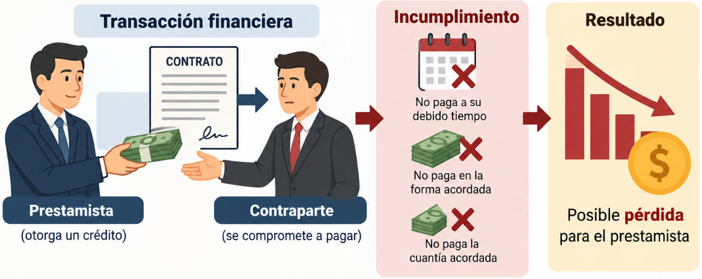
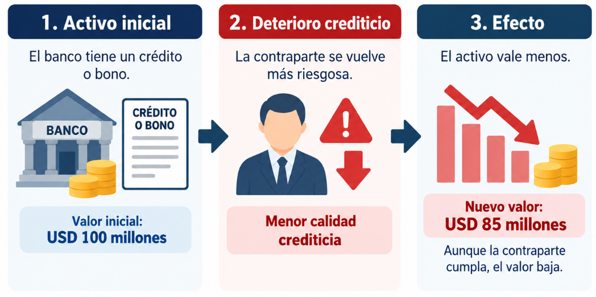

**Pregunta para la clase:**

Por qué existen los Riesgos Financieros?

**¿Cómo funciona financieramente una institución bancaria?**


-   Una institución bancaria mantiene activos que le permiten generar
    ingresos, pero también adquiere obligaciones que debe atender en
    determinadas fechas.

-   Un banco comercial recibe depósitos y otros recursos, que utiliza
    principalmente para conceder préstamos, adquirir inversiones y
    mantener efectivo.

La identidad fundamental es:

$$
\text{Activo} = \text{Pasivo} + \text{Patrimonio}
$$

-   Activo: recursos y derechos económicos que controla la institución;
    por ejemplo, efectivo, créditos e inversiones.

-   Pasivo: obligaciones frente a terceros, como depósitos y
    financiación recibida.

-   Patrimonio: participación residual después de descontar los pasivos
    de los activos.

$$
\text{Patrimonio} = \text{Activo} - \text{Pasivo}
$$

**Ejemplo:**

**Balance general simplificado de un banco**

*Valores en millones de USD.*

| Activos           | Millones USD | Pasivos y patrimonio           | Millones USD |
|:-----------------|-----------------:|:------------------|-----------------:|
| Créditos          |          700 | Depósitos                      |          850 |
| Inversiones       |          200 | Otras obligaciones             |           50 |
| Efectivo          |          100 | Patrimonio                     |          100 |
| **Total activos** |    **1.000** | **Total pasivos y patrimonio** |    **1.000** |

La ecuación contable se cumple:

$$
\boxed{1.000 = 900 + 100}
$$

**Interpretación:** El banco mantiene USD 1.000 millones en activos, de
los cuales USD 900 millones se financian mediante obligaciones y USD 100
millones mediante patrimonio.

Esto significa que por cada USD 100 en activos, USD 90 se financian con
obligaciones y USD 10 con patrimonio.

**¿Qué ocurre si el valor de los activos disminuye o si los depositantes
solicitan sus recursos antes de que el banco pueda recuperar sus
préstamos?**


**Situación 1. Un cliente no paga su crédito**

El banco deja de recibir el dinero previsto y podría reconocer una
pérdida. Esto constituye riesgo de crédito.

**Situación 2. Los depositantes retiran dinero**

El banco debe disponer de recursos líquidos para efectuar pagos, aunque
muchos préstamos todavía no hayan vencido. Esto constituye riesgo de
liquidez.

**Situación 3. Disminuye el valor de las inversiones**

Los cambios en tasas de interés, precios de títulos o cotizaciones
pueden reducir su valor de mercado. Esto constituye riesgo de mercado.

**Ejercicio**

Supongamos que, en el balance anterior, USD 30 millones de la cartera se
pierden de forma definitiva, sin recuperación ni cobertura adicional, y
que la pérdida se reconoce totalmente.

El activo se reduce:

$$
\boxed{\text{Activo}_1 = 1.000 - 30 = 970}
$$

Los pasivos siguen siendo USD 900 millones, por lo que:

$$
\boxed{\text{Patrimonio}_1 = 970 - 900 = 70}
$$

| Variable   | Antes | Después |
|------------|-------|---------|
| Activos    | 1.000 | 970     |
| Pasivos    | 900   | 900     |
| Patrimonio | 100   | 70      |

**Cuanto representa la pérdida?**

La pérdida representa el **3 % de los activos iniciales**, pero consume
el **30 % del patrimonio inicial**.

$$
\frac{30}{100} \times 100 = 30\%
$$

***El patrimonio constituye un recurso de absorción de pérdidas. La
importancia del riesgo no depende exclusivamente de cuánto representa la
pérdida respecto a los activos; también importa cuánto capital puede
absorberla.***

**Diagnóstico**

**Evaluación diagnóstica (0%)**

Responda en 5 minutos, sin calculadora. Sirve para ajustar el ritmo de
la clase.

1.  Un banco tiene activos por 100 y patrimonio por 8. Si pierde 8 en su
    cartera, ¿quién absorbe la pérdida y quién no?

2.  ¿Pesa lo mismo para el capital un préstamo hipotecario que un
    préstamo a una empresa sin calificación?

3.  ¿El BCE puede emitir dólares para atender un retiro masivo de
    depósitos?

4.  Si las tasas de interés suben, ¿qué pasa con el precio de un bono
    que ya está en la cartera?

5.  ¿Quién debería fijar el límite de riesgo de una inversión: el área
    que invierte, el área de riesgos o el directorio?

# Unidad 1. Fundamentos de Riesgo Financiero

La gestión de riesgos financieros constituye un componente esencial de
la estabilidad de las instituciones bancarias y de los bancos centrales.
Sin embargo, los riesgos, los instrumentos de mitigación y los criterios
de evaluación cambian según la naturaleza y el mandato de cada
institución.

## 1.2 Basilea

-   Los bancos utilizan fondos de depositantes y acreedores para
    adquirir activos cuyo valor y recuperación no están garantizados.

-   Si una entidad asume exposiciones excesivas sin capital suficiente,
    una pérdida importante puede comprometer su continuidad. Cuando el
    problema afecta a varias instituciones, existe además un riesgo para
    la estabilidad del sistema financiero.

-   Por esa razón, los supervisores establecen normas prudenciales que
    buscan mejorar la capacidad de los bancos para absorber pérdidas y
    gestionar sus exposiciones.

-   El Comité de Supervisión Bancaria de Basilea desarrolla estándares
    internacionales que las jurisdicciones incorporan a sus propios
    marcos regulatorios.

**Evolución de los acuerdos**

| Acuerdo | Año de referencia | Principal contribución |
|------------------------|------------------------|------------------------|
| Basilea I | 1988 | Introduce un estándar internacional de suficiencia de capital asociado principalmente al riesgo crediticio |
| Basilea II | 2004 | Desarrolla los tres pilares de supervisión y amplía la sensibilidad al riesgo |
| Basilea III | Desde 2010 | Refuerza calidad y cantidad del capital, colchones, apalancamiento, liquidez y medición de riesgos |

El marco de Basilea busca fortalecer la resiliencia de las instituciones
bancarias mediante estándares de

-   Capital

-   Liquidez

-   Gestión de riesgos

-   Supervisión.

Los tres pilares de Basilea II

-   **Pilar 1.** Requisitos mínimos de capital: determina recursos
    regulatorios para cubrir exposiciones de riesgo.

-   **Pilar 2.** Revisión supervisora: permite evaluar riesgos, procesos
    de gestión y suficiencia de capital más allá de los cálculos
    mínimos.

-   **Pilar 3.** Disciplina de mercado: promueve divulgación de
    información relevante para que los participantes comprendan el
    perfil financiero de las entidades.

-   Basilea III mantiene y refuerza este marco.

***"Los Activos de un Banco tienen el mismo Riesgo"***

Consideremos dos exposiciones hipotéticas:

1.  Un instrumento de alta calidad crediticia, con elevada liquidez y
    vencimiento corto.

2.  Un préstamo a un cliente con elevada probabilidad de incumplimiento.

***Aunque ambos tengan un valor nominal de USD 100 millones, su
exposición al riesgo puede ser muy diferente.***

| Activo                        | Valor       | Riesgo |
|-------------------------------|-------------|--------|
| Bonos del Tesoro              | 100.000.000 | Bajo   |
| Prestamó (Cartera de Crédito) | 100.000.000 | Alto   |

-   Los instrumentos de alta calidad crediticia se mantienen líquidos y
    seguros.

-   Los préstamos riesgosos requieren provisiones y pueden deteriorar el
    balance si el cliente incumple.

**Activos ponderados por riesgo (RWA)**

Por ello, las normas prudenciales contemplan activos ponderados por
riesgo, conocidos como **RWA (Risk-Weighted Assets)**.

Para un ejemplo simplificado:

$$ RWA = \sum_{i=1}^{n} E_i w_i $$

Donde:

-   $E_i$ es la exposición (valor nominal del activo).
-   $w_i$ es su ponderación regulatoria correspondiente.

En un cálculo real también intervienen metodologías para distintos tipos
de riesgo, ajustes y tratamientos específicos.

**Ejercicio**

| Exposición | Monto (USD M) | Ponderación supuesta | RWA |
|------------|---------------|----------------------|-----|
| A          | 100           |                      |     |
| B          | 200           |                      |     |
| C          | 300           |                      |     |
| **Total**  | **600**       |                      |     |

**Fórmula aplicada**

$$ RWA = 100(0) + 200(0.5) + 300(1) $$

$$ \boxed{RWA = 400} $$

| Exposición | Monto (USD M) | Ponderación supuesta | RWA     |
|------------|---------------|----------------------|---------|
| A          | 100           | 0%                   | 0       |
| B          | 200           | 50%                  | 100     |
| C          | 300           | 100%                 | 300     |
| **Total**  | **600**       |                      | **400** |

**Interpretación**

El valor contable de las exposiciones es USD 600 millones, mientras que
su importe ponderado por riesgo es USD 400 millones.

La diferencia se debe a que el denominador regulatorio incorpora el
tratamiento de riesgo aplicado a cada exposición, no únicamente sus
montos nominales.

👉 **En resumen:** la exposición es el monto bruto que el banco tiene
invertido o prestado, mientras que el RWA refleja cuánto de ese monto
realmente cuenta como riesgo regulatorio.

## ¿Qué es el capital regulatorio?

No todo el patrimonio contable de un banco es necesariamente admisible
como **capital regulatorio**.\
Los marcos prudenciales clasifican los instrumentos de capital según su
capacidad de absorber pérdidas, permanencia y otras condiciones.

En términos generales:

-   **CET1 (Common Equity Tier 1):** capital ordinario de mayor calidad
    regulatoria.\
-   **Tier 1:** CET1 más otros instrumentos admisibles de nivel 1.\
-   **Capital total:** Tier 1 más capital admisible de nivel 2, sujeto a
    las reglas correspondientes.

**📊 Estándar internacional de Basilea III**

| Indicador               | Mínimo sobre RWA |
|-------------------------|------------------|
| CET1                    | 4.5%             |
| Tier 1                  | 6.0%             |
| Capital total           | 8.0%             |
| Colchón de conservación | +2.5% CET1       |

**📌 Ejemplo aplicado con balance simplificado (Banco en Ecuador)**

**Activo**\
- Caja y Bancos: 50 M\
- Inversiones en Bonos del Estado: 100 M\
- Cartera de Créditos Comerciales: 200 M\
- Cartera de Créditos Hipotecarios: 150 M\
- Activos Intangibles (software, goodwill): 10 M

**Pasivo**\
- Depósitos a la vista: 250 M\
- Depósitos a plazo: 150 M\
- Obligaciones con el exterior: 50 M

**Patrimonio contable**\
- Capital social ordinario: 20 M\
- Reservas legales y acumuladas: 15 M\
- Acciones preferentes: 5 M\
- Deuda subordinada: 10 M\
- Activos intangibles (deducción regulatoria): –10 M

**🧮 Cálculo regulatorio**

$$ CET1 = (20 + 15) - 10 = 25\ \text{M} $$

$$ Tier\ 1 = CET1 + Acciones\ preferentes = 25 + 5 = 30\ \text{M} $$

$$ Capital\ Total = Tier\ 1 + Deuda\ subordinada = 30 + 10 = 40\ \text{M} $$

**📊 Supongamos RWA = 400 M**

| Indicador     | Capital (M USD) | Fórmula              | Ratio calculado |
|---------------|-----------------|----------------------|-----------------|
| CET1          | 25              | $$ \frac{25}{400} $$ | 6.25%           |
| Tier 1        | 30              | $$ \frac{30}{400} $$ | 7.5%            |
| Capital Total | 40              | $$ \frac{40}{400} $$ | 10%             |

**🧩 Colchón de conservación**

El estándar de Basilea III exige un **colchón adicional de 2.5% en
CET1**.\
Esto significa que el mínimo efectivo de CET1 no es 4.5%, sino:

$$ CET1\ mínimo\ efectivo = 4.5\% + 2.5\% = 7.0\% $$

Comparando:

-   CET1 ratio calculado: **6.25%**\
-   CET1 mínimo efectivo: **7.0%**

👉 El banco cumple el mínimo regulatorio de 4.5%, pero no alcanza el
colchón de conservación.\
En la práctica, esto implicaría restricciones en distribución de
utilidades (dividendos, bonos, etc.) hasta que el banco acumule más
capital.

**✅ Interpretación didáctica**

-   El capital regulatorio es la parte del patrimonio que realmente
    cuenta para absorber pérdidas.\

-   Los mínimos de Basilea III aseguran que los bancos mantengan
    colchones suficientes frente a riesgos.\

-   El colchón de conservación (+2.5% CET1) eleva el estándar efectivo y
    obliga a los bancos a mantener capital adicional en épocas normales.

**Qué es la CAR?**

Una vez que conocemos el capital regulatorio y los RWA, podemos
introducir el coeficiente de adecuación de capital.

$$ CAR = \frac{Capital\ regulatorio\ total}{RWA} \times 100 $$\*\*Ejercicio

:   suficiencia de capital\*\*

Supongamos que el banco tiene:

-   Capital regulatorio admisible: USD 60 millones.

-   RWA: USD 400 millones.

$$ CAR = \frac{60}{400} \times 100 = 15\% $$

**Interpretación:** por cada USD 100 de activos ponderados por riesgo,
el banco mantiene USD 15 de capital regulatorio.

**¿Qué pasa si los RWA aumentan a USD 500 millones sin que cambie el
capital?**

$$ CAR_1 = \frac{60}{500} \times 100 = 12\% $$

👉 El CAR disminuye del 15% al 12%. Esto demuestra que el coeficiente
puede deteriorarse porque aumentan las exposiciones ponderadas, incluso
sin que el capital nominal disminuya.

**Pregunta para los estudiantes:**

¿podemos afirmar que una institución con patrimonio/activos de 20% es
más solvente que un banco con CAR de 12%?\
**Respuesta:**

No. Los indicadores tienen diferentes numeradores, denominadores y
objetivos.

## 1.2 ISO 31000

**¿Qué significa gestionar riesgos?**

Identificar un riesgo no es suficiente. Una institución debe comprender
sus causas, estimar sus consecuencias, evaluar si la exposición resulta
aceptable, establecer controles y verificar si estos funcionan.

Por ejemplo, reconocer que una inversión puede perder valor no significa
que el riesgo esté administrado.

Para gestionarlo es necesario determinar qué puede ocasionar la pérdida,
cómo se mide, quién la supervisa, qué límites existen y qué medidas se
adoptarán si la exposición supera lo permitido.

**¿Qué establece ISO 31000?**

La norma ISO 31000:2018 proporciona principios, un marco y un proceso de
gestión de riesgos. Se puede adaptar a diferentes organizaciones y tipos
de exposición.

No establece un requisito específico de capital financiero y no
constituye un sistema de certificación institucional. La edición de 2018
continúa vigente, aunque está en revisión para una futura edición.

### Riesgo inherente y residual

El riesgo inherente es la exposición que se evalúa antes de considerar
los efectos de los controles pertinentes.

El riesgo residual es el que permanece una vez considerados dichos
controles.

Una técnica cualitativa frecuente consiste en asignar niveles ordinales
de probabilidad e impacto.

$$ R = P \times I $$

Este producto constituye una puntuación convencional de matriz. No debe
interpretarse como una probabilidad estadística ni como una pérdida
monetaria.

Se utiliza una escala didáctica de 1 a 5:

| Variable                     | Antes de controles | Después de controles |
|------------------------------|--------------------|----------------------|
| Probabilidad, escala ordinal | 4                  | 2                    |
| Impacto, escala ordinal      | 5                  | 4                    |
| Puntuación                   | 20                 | 8                    |

$$ R_{inherente} = 4 \times 5 = 20 $$
$$ R_{residual} = 2 \times 4 = 8 $$

Los controles considerados son:

-   Límites de exposición por contraparte.

-   Evaluación periódica de calidad crediticia.

-   Diversificación de depósitos e inversiones.

-   Procedimientos de escalamiento cuando se superan límites.

**Interpretación:**

La matriz clasifica el riesgo residual por debajo del inherente. No
podemos afirmar que las pérdidas esperadas se redujeron exactamente 60%,
porque las puntuaciones no representan pérdidas cuantitativas.

### Pérdida esperada (Expected Loss)

Para diferenciar una matriz cualitativa de un modelo financiero,
introduciremos brevemente:

$$ EL = PD \times LGD \times EAD $$

Donde:

-   $(PD)$: probabilidad de incumplimiento.

-   $(LGD)$: proporción de exposición que se perdería condicionada al
    incumplimiento.

-   $(EAD)$: exposición al momento del incumplimiento.

**Ejemplo:**

$$ EL = 0,02 \times 0,40 \times 10.000.000 $$ $$ EL = USD\ 80.000 $$

La pérdida esperada calculada es USD 80.000 durante el horizonte al que
corresponden los parámetros, bajo los supuestos simplificados.

No significa que ocurrirá necesariamente esa pérdida; expresa el valor
esperado del modelo.

En la Unidad 2 profundizaremos en estimación de PD, LGD, EAD,
provisiones y riesgo de contraparte.

> El BCE necesita mantener activos de alta liquidez para atender
> obligaciones, pero parte de las inversiones ofrece mayor rendimiento a
> plazos largos.

Los participantes deben identificar dos riesgos, una posible causa, un
indicador para medir cada riesgo y una medida de control.

Solución orientativa:

| Riesgo | Causa | Indicador | Control |
|------------------|------------------|------------------|------------------|
| Liquidez | Descalce entre vencimientos y obligaciones | Brecha acumulada por plazo | Mantener recursos realizables y límites de liquidez |
| Mercado | Variación de tasas internacionales | Duración, DV01 o sensibilidad | Límites de duración y seguimiento de mercado |

Conclusión: una decisión financiera puede mejorar la rentabilidad
esperada y, simultáneamente, aumentar la exposición al riesgo.

## 1.3 Solvencia

**Qué es la solvencia?**

La solvencia se relaciona con la capacidad patrimonial y financiera de
una institución para absorber pérdidas y sostener sus obligaciones.

La liquidez, en cambio, se refiere a la capacidad de disponer de
recursos oportunamente para cumplir pagos.

| Pregunta | Solvencia | Liquidez |
|------------------------|------------------------|------------------------|
| ¿Cuál es el problema? | Pérdidas que deterioran la posición patrimonial | Incapacidad de atender pagos en el momento requerido |
| ¿Qué se analiza? | Activos, pasivos, capital o patrimonio | Flujos, vencimientos y disponibilidad de recursos |
| ¿Puede existir con patrimonio positivo? | El deterioro patrimonial puede preceder a la insolvencia | Sí, puede haber problemas de liquidez con patrimonio positivo |

**Ejemplo conceptual**

Un banco tiene USD 1.000 millones en activos, USD 900 millones en
pasivos y USD 100 millones en patrimonio.

Sus activos incluyen préstamos de largo plazo, pero mañana debe pagar
USD 200 millones.

Si solo tiene USD 50 millones líquidos y no dispone de otras fuentes de
fondos oportunas, puede experimentar un problema de liquidez, aunque
mantenga patrimonio positivo.

Esta distinción será fundamental para el análisis del BCE.

**Solvencia en un banco**

En la banca comercial no basta con conocer el patrimonio contable.

La suficiencia regulatoria del capital depende de la definición de
capital admisible, las deducciones pertinentes, la ponderación de
exposiciones y otros requisitos prudenciales aplicables.

Por eso, para la banca utilizaremos dos indicadores distintos:

$$ \text{Patrimonio/Activo} = \frac{Patrimonio}{Activo} \times 100 $$

$$ CAR = \frac{Capital\ regulatorio}{RWA} \times 100 $$

El primero describe una proporción contable. El segundo evalúa
suficiencia de capital conforme a un marco prudencial.

**Ejemplo BCE 2025:**

Ahora utilizaremos los estados financieros auditados del Banco Central
del Ecuador, al 31 de diciembre de 2025.

Importes en millones de dólares, redondeados.

| Concepto   | 2024      | 2025      |
|------------|-----------|-----------|
| Activos    | 15.102,18 | 17.841,27 |
| Pasivos    | 12.284,99 | 13.507,29 |
| Patrimonio | 2.817,19  | 4.333,98  |

Fuente: BCE, Estados Financieros Auditados 2025, estado de situación
financiera comparativo.

**Ejercicio**

$$ \frac{4.333,98}{17.841,27} \times 100 = 24,29\% $$

**¿Qué significa?**

Por cada USD 100 de activos registrados, aproximadamente USD 24,29
corresponden al patrimonio contable.

No significa que el BCE mantenga USD 24,29 de efectivo disponible por
cada USD 100 de activos, ni que ese porcentaje sea un CAR bancario.

## Ejemplo: Patrimonio sobre Activos del BCE

Para 2024:

$$ PA_{2024} = \frac{2.817,19}{15.102,18} \times 100 \approx 18,65\% $$

Para 2025:

$$ PA_{2025} = \frac{4.333,98}{17.841,27} \times 100 \approx 24,29\% $$

El indicador aumenta aproximadamente:

$$ 24,29 - 18,65 = 5,64\ \text{puntos porcentuales} $$

**Interpretación:** la proporción patrimonial contable es mayor en 2025.
Sin embargo, para determinar sus causas necesitamos examinar la
evolución de resultados, ajustes de valoración y movimientos
patrimoniales.

Un indicador mayor no demuestra por sí solo que todos los riesgos
financieros hayan disminuido.

### Pregunta de discusión

¿Por qué no podemos comparar el CAR de Banco Pichincha con el cociente
patrimonio/activos del BCE?

## 1.4 Riesgo Financiero

**¿Qué cambia cuando un país no emite la moneda que utiliza?**

En Ecuador, el dólar estadounidense es la moneda de curso legal. El BCE
no emite billetes de dólares y no controla directamente las decisiones
de la Reserva Federal de Estados Unidos.

La excepción relevante es que Ecuador mantiene atribuciones legales
sobre moneda metálica fraccionaria nacional. Por tanto, la formulación
técnicamente correcta no es «el BCE no puede emitir absolutamente
ninguna moneda», sino que no puede emitir los billetes de dólares
estadounidenses que circulan en la economía.

Esto introduce varias particularidades.

| Dimensión | Consecuencia en Ecuador |
|------------------------------------|------------------------------------|
| Emisión monetaria | No se pueden crear billetes USD mediante emisión propia |
| Liquidez | Depende de los recursos y mecanismos disponibles legalmente |
| Tasas internacionales | Las condiciones de financiamiento e inversión en USD están influidas por los mercados internacionales |
| Reservas internacionales | Tienen particular relevancia para la liquidez externa y el funcionamiento de la dolarización |
| Riesgo cambiario | No existe riesgo de depreciación de una moneda nacional propia frente al USD, pero sí exposiciones a otras divisas |
| Rentabilidad de reservas | Debe analizarse junto con seguridad y liquidez, no como objetivo único |

No debemos concluir que el BCE carece de funciones monetarias o de
mecanismos para administrar liquidez. Lo correcto es identificar las
herramientas efectivamente previstas en su marco jurídico.

**Riesgo de crédito**

Ocurre cuando un deudor o contraparte no cumple sus obligaciones
financieras.

En un banco comercial, una exposición típica es un préstamo. En el BCE,
este riesgo puede relacionarse con determinadas inversiones, depósitos,
operaciones y contrapartes.

La diferencia está en la naturaleza de las posiciones y en el mandato
institucional.

**Ejemplo**

Un banco mantiene un crédito de USD 10 millones. El deudor incumple y,
después de las recuperaciones, se pierde el 30% de la exposición.

$$ Pérdida = 10.000.000 (0,30) $$

$$ \boxed{Pérdida = USD\ 3.000.000} $$

Es una pérdida realizada o estimada bajo el escenario descrito, no una
pérdida esperada probabilística.

Para calcular esta última necesitaríamos incorporar la probabilidad de
incumplimiento y las demás variables del modelo.

**Riesgo de Liquidez**

Una institución enfrenta riesgo de liquidez cuando puede tener
dificultades para obtener los recursos necesarios a tiempo, o necesita
liquidar activos en condiciones desfavorables.

En Ecuador, este tema es especialmente relevante porque el BCE no puede
recurrir a la emisión autónoma de dólares estadounidenses.

**Caso real BCE: vencimientos de diciembre de 2025**

El informe auditado presenta las siguientes posiciones financieras,
expresadas en millones de dólares.

| Vencimiento   | Activos  | Pasivos   |
|---------------|----------|-----------|
| Hasta 30 días | 8.448,36 | 12.456,64 |
| 31–90 días    | 1.332,70 | 0         |
| 91–180 días   | 703,02   | 0         |
| 181–360 días  | 345,75   | 0         |
| Más de un año | 6.838,57 | 1.050,65  |

**Ejercicio:** Brecha de Liquidez

$$ Brecha_t = Activos_t - Pasivos_t $$

Para la banda de hasta 30 días:

$$ Brecha_{30d} = 8.448,36 - 12.456,64 = -4.008,29\ millones $$

**Interpretación:** las obligaciones clasificadas en esa banda superan a
los activos registrados en el mismo intervalo.

Esto representa una asimetría de vencimientos; no constituye por sí solo
evidencia de incumplimiento o insolvencia. La capacidad real de atención
de pagos también depende de la liquidez inmediata, las entradas y
salidas efectivas y las fuentes de recursos disponibles.

**El concepto de cobertura**

El informe auditado también presenta que, a diciembre de 2025, los
activos con disponibilidad o vencimiento a un día cubrían el 42% de los
pasivos exigibles a ese plazo.

Este porcentaje mide una relación específica de liquidez, no una
cobertura total de las obligaciones por reservas internacionales.

La enseñanza consiste en reconocer que el resultado de un indicador
depende de sus definiciones, su plazo y los activos que incluye.

**Riesgo de Mercado**

Surge cuando los precios, rendimientos o cotizaciones de mercado
modifican el valor de los activos y pasivos expuestos.

En esta unidad introduciremos tres factores relevantes:

-   Tasas de interés.

-   Cotizaciones de divisas.

-   Precio del oro.

En la Unidad 4 desarrollaremos duración, convexidad, volatilidad, VaR y
Expected Shortfall/CVaR.

**Ejemplo: tasas de interés y bonos**

Para un instrumento de renta fija, el aumento de los rendimientos de
mercado suele asociarse con una caída de su precio.

Una aproximación es:

**Riesgo de tipo de cambio y dolarización**

Una confusión frecuente es afirmar que en Ecuador no existe riesgo
cambiario porque su moneda de uso es el dólar.\
Eso es incorrecto. El BCE puede mantener activos y obligaciones
denominados en distintas monedas o unidades de cuenta, cuya valoración
en USD varía con las cotizaciones internacionales.

**Ejercicio ilustrativo:**

\
Supongamos que una institución posee **EUR 10 millones**.

Cotización inicial:

$$ 1\ EUR = 1,10\ USD $$

Valor inicial:

$$ V_0 = 10.000.000 (1,10) = USD\ 11.000.000 $$

Cotización posterior:

$$ 1\ EUR = 1,05\ USD $$

Valor posterior:

$$ V_1 = 10.000.000 (1,05) = USD\ 10.500.000 $$

Variación:

$$ \Delta V = 10.500.000 - 11.000.000 $$

$$ \boxed{\Delta V = -USD\ 500.000} $$

La posición pierde valor expresado en USD, aunque el número de euros
permanezca constante.

**Conclusión:** la dolarización elimina la emisión propia de una moneda
nacional distinta al dólar como instrumento convencional, pero **no
elimina las exposiciones cambiarias internacionales**.

## 1.5 Gobierno Financiero

**¿Por qué no basta con medir los riesgos?**

Supongamos que una unidad técnica calcula que cierta inversión presenta
una elevada exposición a pérdidas.

La información, por sí sola, no garantiza que el riesgo esté bajo
control.

Es necesario responder:

-   ¿Quién autorizó la inversión?

-   ¿Qué límite se aprobó?

-   ¿Quién vigila su cumplimiento?

-   ¿Quién decide cuando se supera el límite?

-   ¿Quién evalúa de manera independiente los controles?

Estas preguntas corresponden al gobierno financiero y al gobierno de
riesgos.

**Marco Legal Ecuatoriano**

Para esta parte de la clase utilizaremos el marco normativo vigente y
distinguiremos las funciones de sus diferentes disposiciones.

| Instrumento | Aspecto relevante para la clase |
|------------------------------------|------------------------------------|
| Constitución, art. 302 | Objetivos de las políticas monetaria, crediticia, cambiaria y financiera |
| Constitución, art. 303 | Formulación e instrumentación de políticas y papel del BCE |
| Código Orgánico Monetario y Financiero | Mandato, funciones, operaciones y régimen del BCE |
| Reformas de 2021 | Marco relacionado con la defensa de la dolarización, autonomía y estructura financiera |
| Reforma de octubre de 2025 | Organización actualizada de la Junta y gobierno institucional |
| Resolución JPRFM-2025-011-M | Marco de administración integral de riesgos |
| Estatuto y normativa interna vigentes | Funciones, responsabilidades y procedimientos específicos |

Según los estados financieros auditados de 2025, la reforma publicada el
13 de octubre de 2025 estableció la Junta de Política y Regulación
Financiera y Monetaria como máximo órgano de gobierno del BCE.

**Enfoque de tres líneas**


**Apetito, tolerancia y límites de riesgo**

Estos conceptos están relacionados, pero no significan lo mismo.

**Apetito de riesgo:** nivel y tipo de riesgo que una organización está
dispuesta a asumir para alcanzar sus objetivos.

**Tolerancia al riesgo:** variación o desviación aceptable dentro de
determinados criterios.

**Límites de riesgo:** restricciones operativas cuantificadas para
controlar exposiciones específicas.

Una cartera hipotética mantiene:

$$ Duración_{observada} = 5,5\ \text{años} $$

Su límite interno supuesto es:

$$ Duración_{límite} = 4\ \text{años} $$

**Exceso:**

$$ 5,5 - 4 = 1,5\ \text{años} $$

**Exceso relativo:**

$$ \frac{1,5}{4} \times 100 = 37,5\% $$

**Resultado:** la duración supera en **37,5%** el límite supuesto.

**¿Qué debe hacer la institución?**

No basta con indicar que el portafolio está generando más rendimiento.
Se debe establecer la causa del exceso, medir sus consecuencias y
activar los procedimientos de comunicación, corrección o autorización
previstos.

La unidad que ejecuta las inversiones no debería otorgarse
unilateralmente una excepción a sus propios límites si carece de
competencia formal para hacerlo.

# Unidad 2. Riesgo de Crédito

**Objetivo:** Analizar riesgo de crédito mediante indicadores
financieros para identificar exposición institucional.

**Antes de comenzar: tres ideas que todos deben manejar**

1.  **Activo:** Lo que posee una institución o el derecho a cobrar. Un
    crédito otorgado es un activo para el banco.
2.  **Saldo de crédito:** Capital pendiente de recuperar. No es lo mismo
    que el monto originalmente prestado.
3.  **Pérdida:** Dinero que probablemente no se recuperará;
    **exposición** y **pérdida** no significan lo mismo.

**Glosario sin tecnicismos**

| Término | En palabras sencillas | Término técnico |
|------------------------|------------------------|------------------------|
| Atraso | La cuota no se pagó a tiempo | Mora |
| Incumplimiento | El crédito alcanza el criterio definido de default | *Default* |
| Frecuencia de incumplimiento | Qué parte de una cohorte llegó a default | Estimador histórico de PD / PI |
| Dinero pendiente al incumplir | Capital expuesto cuando ocurre el default | EAD / EAI simplificada |
| Porción no recuperada | Qué parte de la EAD se pierde | LGD / PDI |
| Pérdida proyectada | Combinar posibilidad de default, exposición y severidad | EL o pérdida esperada |

**Escenario 1**



**Escenario 2**



**Al principio, William es un buen cliente..**

William tiene un trabajo estable, gana USD 3.000 mensuales y siempre
paga sus deudas.

**El banco piensa:**

"William tiene dinero suficiente para pagarme. Es poco probable que no
me devuelva el préstamo".

Por eso, el banco confía en William.

**Un día, la situación de William empeora**

Ahora imagina que William pierde su trabajo y consigue otro donde gana
USD 700 mensuales.

**Pero hay algo importante:**

William todavía está pagando puntualmente todas las cuotas de su
préstamo.

Entonces, **¿cuál es el problema?**

**El banco piensa:**

"Antes William ganaba USD 3.000 y podía pagarme fácilmente. Ahora gana
USD 700 y, aunque sigue pagando, existe una mayor posibilidad de que en
el futuro no pueda hacerlo".

Eso es el deterioro de la calidad crediticia de la contraparte.

En palabras sencillas:

-   **Contraparte:** William, la persona que debe pagar.

-   **Calidad crediticia:** Qué tan capaz es William de cumplir sus
    obligaciones.

-   **Deterioro:** Su situación económica empeoró y ahora ***hay más
    riesgo de que no pague***.

| Riesgo de crédito en sentido estricto | Riesgo de crédito en sentido amplio |
|------------------------------------|------------------------------------|
| William deja de pagar una cuota que debía pagar. | William sigue pagando, pero su situación económica empeora. |
| Existe un incumplimiento. | Existe un deterioro de su calidad crediticia. |
| El banco puede sufrir una pérdida por el impago. | El crédito puede perder valor antes de que exista un impago. |

**Por lo tanto, la calidad del riesgo puede estar determinada tanto por
la probabilidad de que se produzca el incumplimiento del contrato, como
por la reducción de las garantías.**

**Un ejemplo que acompañará toda la unidad**

Una institución otorga un crédito de USD 10.000. Con el tiempo el
cliente paga algunas cuotas y el saldo baja; después deja de pagar.
¿Puede el banco perder USD 10.000?

No necesariamente: primero debemos saber cuánto estaba pendiente, si
efectivamente ocurrió default y cuánto logró recuperar. Las secciones
2.1 a 2.5 responden estas preguntas en orden.

**Cinco segmentos y sus diferencias**

Cada segmento tiene una estructura distinta de deudores, tamaño y
vencimientos. No es correcto interpretar que una tasa de mora más alta
implica automáticamente mayor PD individual o mayor LGD.

| Segmento | Caso cotidiano | Qué miraremos |
|------------------------|------------------------|------------------------|
| Productivo | Una empresa financia maquinaria o capital de trabajo | Exposición de empresas, comportamiento y concentración |
| Microcrédito | Un pequeño negocio financia inventarios | Incumplimientos, morosidad y recuperación |
| Consumo | Una familia financia una compra personal | Calidad de cartera y pagos mensuales |
| Vivienda | Un hogar financia la compra de una casa | Plazos y posibles recuperaciones con garantías |
| Educativo | Una persona financia estudios | Tamaño de segmento y comportamiento de pagos |

Las cifras son saldos agregados por banco y segmento, no datos de
prestatarios. En cada corte se suman *por vencer*, *no devenga
intereses* y *vencida*.

## 2.1 Evaluación crediticia

**Situación de partida: ¿prestarías tu dinero?**

Dos personas solicitan un préstamo por el mismo valor. Una tiene
ingresos estables, deudas manejables y un buen historial; otra presenta
atrasos reiterados y cuotas que consumen casi todo su ingreso.

**El riesgo de crédito comienza antes del desembolso:**

-   Hay que evaluar si el deudor podrá pagar.

-   Un banco central hace algo análogo al elegir emisores y
    contrapartes, aunque no otorgue créditos de consumo

**¿Quién solicita el crédito? Conectar persona, préstamo e historial**

**Ejercicio: De la historia al indicador**

Una persona solicita un crédito.

Antes de desembolsar, el banco observa ingresos, cuotas de otras deudas,
cuota nueva, actividad laboral y atrasos *anteriores*.

Meses después ve si pagó o incumplió. Son momentos distintos:
**evaluación inicial** y **seguimiento posterior**.

La base `06_perfil_solicitante_SINTETICO.csv` contiene
informacióncorrespondiente a exactamente los mismos 1.000 `id_credito`
de la base de préstamos.

Para empezar usamos la **carga financiera**:

$$
Carga\ financiera=rac{Cuota\ del\ crédito+Otras\ cuotas}{Ingreso\ mensual} imes100
$$

***Ejemplo manual**:* ingreso USD 1.500, cuota nueva USD 300, otras
cuotas USD 150: $$((300+150)/1500)x100=30\%$$Esto mide proporción del
ingreso comprometido, no la PD y no basta por sí solo para aprobar un
préstamo.

-   La actividad económica puede señalar exposición a distintos ciclos
    económicos

-   No asignamos un riesgo automático por ser agricultor, trabajador
    público o privado.

-   La variable sexo se reserva para auditar equidad y sesgos, nunca
    para decidir a quién prestar.

**Pregunta de nivel fundamental:**

¿Qué diferencia existe entre ganar USD 2.000 y disponer de USD 2.000
para pagar deudas?

**Profundización:** ¿qué otras variables de gasto y estabilidad de
ingresos faltarían para una evaluación real?

**Paso práctico A: inspeccionar perfiles**

``` python
# Mostrar cómo son las personas de nuestro ejemplo ficticio
print(perfil.head())

# Revisar que cada crédito tenga un perfil
print('Créditos con perfil:', perfil['id_credito'].nunique())
```

**Paso práctico B: calcular la carga financiera**

``` python
# Unir el perfil con los datos del préstamo usando id_credito
clientes = creditos.merge(perfil, on='id_credito')

# Calcular la carga financiera mensual de cada persona
clientes['carga_pct'] = 100 * (
    clientes['cuota_credito_mensual_usd'] +
    clientes['otras_cuotas_mensuales_usd']
) / clientes['ingreso_mensual_usd']

print(clientes[['id_credito','segmento','ingreso_mensual_usd',
                'carga_pct','atrasos_previos_12m']].head())
```

**Situación de partida: ¿prestarías tu dinero?**

Dos personas solicitan un préstamo por el mismo valor. Una tiene
ingresos estables, deudas manejables y un buen historial; otra presenta
atrasos reiterados y cuotas que consumen casi todo su ingreso. **El
riesgo de crédito comienza antes del desembolso**: hay que evaluar si el
deudor podrá pagar. Un banco central hace algo análogo al elegir
emisores y contrapartes, aunque no otorgue créditos de consumo.

### Ejercicio cinco segmentos: de la historia al indicador

**Situación:** un supervisor observa la cartera de cinco segmentos al
mismo corte. No basta preguntar cuál tiene más mora en dólares: hay que
calcular la proporción respecto a su cartera y observar cuánto
representa en el total.

$$
\text{Cartera improductiva}=\text{No devenga intereses}+\text{Cartera vencida}
$$

$$
\text{Morosidad (\%)}=100\times\frac{\text{Cartera improductiva}}{\text{Saldo total de cartera}}
$$

**Ejemplo manual hipotético:** consumo tiene USD 1.000 millones de
saldo, USD 30 millones que no devengan intereses y USD 20 millones
vencidos: improductiva = 30 + 20 = USD 50 millones; morosidad = 50 /
1.000 × 100 = **5 %**. Esto no es una PD anual.

**Ahora con bancos comerciales reales y cinco segmentos:**

**Ejercicio en Python**

``` python
# Elegir un corte completo de los archivos proporcionados
base = cartera[cartera['periodo'] == '2025-12']

# Agrupar por segmento y sumar columnas de saldo
resumen5 = base.groupby('segmento')[
    ['total_usd', 'no_devenga_usd', 'vencida_usd']
].sum()

# Morosidad: primero sumar, después dividir
resumen5['mora_pct'] = 100 * (
    resumen5['no_devenga_usd'] + resumen5['vencida_usd']
) / resumen5['total_usd']

print(resumen5[['total_usd', 'mora_pct']].round(2))
```

**Nivel fundamental:** identifica el segmento con mayor saldo y el de
mayor morosidad. ¿Son el mismo? **Nivel avanzado:** explica cómo podría
cambiar el ranking por incorporar un banco que no operaba en otro corte.

**En el BCE:** la cartera minorista por segmento no es el objeto
principal de este análisis; en su lugar se evalúan emisores, inversiones
y contrapartes a partir de estados y notas auditadas. No fabriques un
indicador de mora del BCE dividiendo cualquier provisión entre activos
totales.

**¿Qué es evaluar riesgo de crédito?**

Una evaluación crediticia estudia **la capacidad y disposición para
pagar**, con atención a flujos de caja, endeudamiento, garantías,
comportamiento histórico y entorno económico. La exposición crediticia
de una institución es el valor vulnerable al incumplimiento, no
necesariamente una pérdida. Para un banco comercial, los estados de la
cartera ayudan a vigilar su calidad; **un agregado por banco no permite
aprobar o rechazar préstamos individuales**.

**Cinco preguntas iniciales de evaluación**

-   **¿Puede pagar?** Ingresos y flujos disponibles.
-   **¿Ha pagado?** Historial de cumplimiento.
-   **¿Cuánto debe?** Endeudamiento y otras obligaciones.
-   **¿Qué respaldo existe?** Garantías y su valor realizable.
-   **¿Qué riesgos enfrenta?** Sector económico y condiciones externas.

El *scoring* convierte ciertos atributos en una puntuación; un *rating*
clasifica la calidad crediticia de emisores o deudores.

**Una puntuación simplificada en clase no es un modelo de aprobación ni
sustituye políticas institucionales.**

**Mini-ejercicio de puntuación — totalmente hipotético**

| Factor                              | Cliente A | Cliente B |
|-------------------------------------|----------:|----------:|
| Pagos sin atrasos (0–2 puntos)      |         2 |         0 |
| Ingreso suficiente (0–2 puntos)     |         2 |         1 |
| Endeudamiento moderado (0–2 puntos) |         2 |         0 |
| **Total sobre 6**                   |     **6** |     **1** |

**Fundamental:** ¿a quién analizarías con mayor cautela y por qué?
**Profundización:** ¿por qué este puntaje no estima automáticamente una
PD?

**Ejemplo teórico: cobertura del servicio de deuda**

Una empresa dispone de USD 360.000 para pagar USD 300.000 de intereses y
capital durante un año. Su cobertura es:

$$
DSCR=\frac{Flujo\ disponible\ para\ servicio\ de\ deuda}{Servicio\ de\ deuda}=\frac{360.000}{300.000}=1,20
$$

Tiene USD 1,20 de flujo por cada USD 1 de servicio de deuda bajo estos
supuestos; esto no garantiza ausencia de default.

**Cómo leer la fórmula:** arriba está el dinero disponible; abajo, las
cuotas que deben pagarse.

Si disponemos de USD 360.000 y necesitamos USD 300.000, dividimos
360.000 entre 300.000. El resultado 1,20 **no es 120 % de probabilidad
de pago**; indica cobertura del flujo respecto al servicio de deuda.

**Banco comercial: cartera productiva frente a microcrédito**

**Dato observado:** los CSV contienen saldos por segmento y banco;
primero elegimos diciembre 2025 y sumamos la cartera según su segmento,
excluyendo únicamente las filas marcadas como instituciones en
liquidación para el cuadro comparable. Recuerda: la cartera productiva
es un segmento crediticio, no todo el activo del banco.

**Ejercicio en Python**

``` python
base_2025 = cartera[
    (cartera['periodo'] == '2025-12') &
    (cartera['en_liquidacion'] == False)
]

resumen = base_2025.groupby('segmento')[
    ['total_usd','no_devenga_usd','vencida_usd']
].sum()
resumen['total_millones'] = resumen['total_usd'] / 1_000_000
print(resumen[['total_millones']])
```

**Preguntas de interpretación:**

¿Cuál segmento tiene mayor volumen?

¿Mayor saldo significa necesariamente mayor riesgo?

**No: la exposición y el deterioro son dimensiones distintas.**

### Aplicación BCE

-   En el BCE, evaluar crédito no equivale a aprobar microcréditos.

-   Se estudia el riesgo de emisores de instrumentos financieros, bancos
    depositarios y contrapartes: calidad de crédito, elegibilidad,
    plazo, concentración y límites.

-   La preferencia institucional por seguridad y liquidez no debe
    sustituirse por una búsqueda exclusiva de rentabilidad.

-   Los estados auditados de 2025 presentan políticas sobre riesgo
    crediticio y estimación de pérdidas crediticias.

## 2.2 Incumplimiento y PD

**Situación de partida: una cuota atrasada no siempre significa
default**

Una persona puede pagar con 10 días de retraso. Otra acumula 100 días
sin pagar. Hay que distinguir **atraso**, **clasificación contable de
cartera** e **incumplimiento**. Para la práctica de historias ficticias
estableceremos expresamente la regla didáctica de 90 días; no
afirmaremos que todas las operaciones ecuatorianas se rigen por un
umbral único.

**Mora observada, default y probabilidad**

La morosidad es una **fotografía de saldos** deteriorados a una fecha;
la PD es una **probabilidad de transición** al incumplimiento en un
horizonte. En la base pública definimos cartera improductiva como *no
devenga intereses más cartera vencida*:

$$
Morosidad_t=\frac{Cartera\ que\ no\ devenga_t+Cartera\ vencida_t}{Saldo\ total\ de\ cartera_t}\times100
$$

Primero **sumamos importes** y después dividimos. No hay que promediar
porcentajes de distintos bancos o cantones.

**Ejemplo comercial con datos observados**

**Ejercicio en Python**

``` python
resumen['improductiva'] = resumen['no_devenga_usd'] + resumen['vencida_usd']
resumen['morosidad_pct'] = 100 * resumen['improductiva'] / resumen['total_usd']
print(resumen[['total_millones','morosidad_pct']].round(2))

resumen['morosidad_pct'].plot(kind='bar', title='Morosidad por segmento - dic. 2025')
plt.ylabel('Porcentaje')
plt.show()
```

Una mora observada del 6% **no significa** que PD anual sea 6%. La
primera mide saldo improductivo en el corte; la segunda requiere seguir
créditos inicialmente sanos y observar nuevos incumplimientos.

**¿Cómo estimar PD con historial individual?**

En el taller hay créditos ficticios con identificador `id_credito`, días
de mora y una fila por mes. Para **esta práctica solamente**, definimos
default cuando un crédito alcanza **90 o más días de mora por primera
vez**. Es una convención docente que no reemplaza definiciones
regulatorias de Ecuador. Todos los 1.000 créditos se originan al
comienzo de 2025; el horizonte de observación de default es
enero–diciembre de 2025.

$$
\widehat{PD}_{12m}=\frac{N\acute{u}mero\ de\ cr\acute{e}ditos\ de\ la\ cohorte\ que\ incumplieron\ en\ 12\ meses}{N\acute{u}mero\ de\ cr\acute{e}ditos\ de\ la\ cohorte\ inicial}
$$

Para que un crédito no se cuente varias veces, usamos `.nunique()` sobre
el identificador.

**Ejercicio en Python**

``` python
hist_2025 = historial[historial['fecha_corte'] <= '2025-12-31']
malos = hist_2025[hist_2025['dias_mora'] >= 90]
n_default = malos['id_credito'].nunique()
n_inicial = creditos['id_credito'].nunique()
pd_historica = n_default / n_inicial
print('Créditos al inicio:', n_inicial)
print('Créditos que incumplieron:', n_default)
print('PD histórica de cohorte:', round(pd_historica * 100, 2), '%')
```

**Del perfil inicial al incumplimiento observado**

Ahora conectamos los datos al solicitar el crédito con lo ocurrido en
los siguientes doce meses. El indicador `incumplio` se obtiene del
historial (no es un dato entregado al principio). Compararemos grupos
por antecedentes de pago, sin interpretar la diferencia como causal ni
como un modelo predictivo calibrado.

**Fundamental:**

Qué grupo tiene más incumplimientos observados?

**Profundización:**

¿por qué sería incorrecto concluir que una variable causa el default
solo por comparar promedios?

¿Cómo evaluaríamos sesgos antes de usar un modelo en decisiones reales?

**Paso práctico: comparar perfiles y default histórico**

``` python
# Marcar incumplimientos observados durante 2025
clientes['incumplio'] = clientes['id_credito'].isin(malos['id_credito']).astype(int)

# Comparar frecuencias por atrasos anteriores
comparacion = clientes.groupby('atrasos_previos_12m')['incumplio'].agg(['count','sum','mean'])
comparacion['pd_historica_pct'] = comparacion['mean'] * 100
print(comparacion[['count','sum','pd_historica_pct']].round(2))
```

**BCE:** un emisor o una institución depositaria puede incumplir sus
obligaciones. La PD para esos instrumentos debe considerar horizonte,
tipo de contraparte y metodología aplicable; no se toma la morosidad de
los bancos privados como PD de una inversión del BCE.

**2.3 Exposición, EAD y pérdida esperada**

**Situación de partida: prestar USD 10.000 no significa que siempre haya
USD 10.000 expuestos**

Si una persona ya pagó USD 4.000 de capital y luego incumple, quedan
aproximadamente USD 6.000 de capital por cobrar (ignorando intereses y
otros cargos). **La exposición cambia con los pagos**. En el banco
central, cambia también por el tipo de instrumento, su vencimiento y la
contraparte.

**¿Cuánto está en riesgo?**

*EAD* significa **exposición al momento del incumplimiento**. Para un
préstamo plenamente desembolsado sin líneas adicionales, aproximaremos
la EAD mediante el **saldo de capital registrado en el primer mes de
default**. Es una simplificación: no considera intereses devengados,
contingentes o límites no dispuestos.

$$
EL=PD\times LGD\times EAD
$$

-   **PD:** posibilidad de incumplimiento durante un período.
-   **LGD:** fracción de la exposición que no se recupera, considerando
    costos y valor temporal según el modelo.
-   **EAD:** saldo estimado al producirse el default.

Ejemplo puramente teórico: si PD = 5%, LGD = 60% y EAD = USD 10.000,
entonces:

$$
EL=0,05\times0,60\times10.000=USD\ 300
$$

**Exposición del sistema bancario: concentración por institución**

Con los datos públicos de diciembre 2025 podemos calcular cuánto
representa un banco dentro del universo disponible, por segmento. Este
indicador es **concentración de cartera en el conjunto de bancos**, no
concentración de un banco en un deudor.

**Ejercicio en Python**

``` python
productivo = base_2025[base_2025['segmento'] == 'PRODUCTIVO']
por_banco = productivo.groupby('banco')['total_usd'].sum().sort_values(ascending=False)
participacion = 100 * por_banco / por_banco.sum()
print(participacion.head(5).round(2))
```

**Determinar EAD sin que venga calculada**

Filtramos los registros que alcanzaron 90 días de atraso y nos quedamos
con **el primer corte de default** de cada crédito. Su saldo es la
exposición observada en el evento.

**Ejercicio en Python**

``` python
primer_default = malos.sort_values('fecha_corte').drop_duplicates('id_credito')

EAD_total = primer_default['saldo_capital_usd'].sum()
print('Créditos en default:', len(primer_default))
print('EAD total de incumplidos (USD):', round(EAD_total, 2))
print(primer_default[['id_credito','fecha_corte','saldo_capital_usd']].head())
```

**Aplicación BCE:** para una inversión, el concepto de exposición puede
incluir valor en libros y otros elementos según su instrumento. El
balance completo del BCE no es la EAD de una contraparte. No sustituimos
activos totales por EAD ni usamos el CAR bancario como medida de riesgo
del BCE.

## 2.4 Provisiones, recuperaciones y LGD

**Situación de partida: el banco presta hoy, pero debe reconocer el
posible deterioro**

Una pérdida no aparece mágicamente al final del proceso. Las
instituciones realizan estimaciones de deterioro de acuerdo con
políticas contables y normas aplicables. Una provisión afecta resultados
y el valor contable de los activos, pero **no es una bolsa de efectivo
reservada en una caja**.

**¿Qué representa una provisión?**

Una provisión o estimación de deterioro reconoce pérdidas crediticias
bajo la política contable y la regulación aplicable. **Pérdida esperada
calculada en un modelo ≠ provisión contable obligatoria**: los
horizontes, tratamientos, etapas y definiciones pueden diferir.

**Banca comercial:** los balances mensuales cargados contienen la cuenta
contable `1499`, referida a provisiones para créditos incobrables. Su
signo, jerarquía y denominador deben conciliarse antes de reportar una
tasa oficial de cobertura. No se asume que `1499 / 14` sea directamente
la cobertura regulatoria.

**BCE:** los estados auditados 2025 explican la pérdida crediticia
esperada con la notación institucional:

$$
PCE=PI\times PDI\times EAI
$$

PI corresponde a PD, PDI a LGD y EAI a EAD. En la nota se reconocen las
etapas I, II y III del deterioro. Esto muestra cómo el concepto sí es
relevante para el BCE aunque sus exposiciones no sean créditos
minoristas. La provisión por riesgo de inversiones incluida en el
conjunto documental es distinta de un default observado en
microcréditos.

**Estimar LGD *desde recuperaciones*, no desde una columna supuesta**

Después del incumplimiento, algunos créditos tienen cobros y costos de
recuperación. Para una simplificación de aula, sumamos recuperaciones
**netas de costos** registradas hasta junio 2026:

$$
LGD_{observada}=1-\frac{Recuperaciones\ netas\ posteriores\ al\ default}{EAD\ al\ default}
$$

La ventana de recuperación está truncada en junio de 2026: **esta LGD no
es definitiva**, y la estimación profesional exigiría descontar flujos,
definir costos elegibles y manejar recuperaciones posteriores.

**Ejercicio en Python**

``` python
recuperaciones['neto_usd'] = (
    recuperaciones['recuperacion_usd'] - recuperaciones['costo_recuperacion_usd']
)
neto_total = recuperaciones['neto_usd'].sum()
lgd_observada = 1 - neto_total / EAD_total
print('Recuperaciones netas (USD):', round(neto_total, 2))
print('LGD observada provisional:', round(100 * lgd_observada, 2), '%')
```

**Caso BCE con cifras documentales**

Los estados financieros auditados suministrados muestran cifras de
patrimonio, activos y ciertas provisiones. Antes de utilizar el monto de
provisión en un reporte oficial debe comprobarse la unidad de
presentación de la nota original. **Estos son saldos contables, no
probabilidades de default.** Comparamos una provisión por riesgo de
inversiones publicada entre 2024 y 2025, teniendo presente que la escala
de la nota debe conservarse como está indicada en el documento original.

**Ejercicio en Python**

``` python
provision_bce = bce[bce['concepto'] == 'Provisión por riesgo de inversiones (nota)']
print(provision_bce[['anio','valor_usd_millones','alcance']])

if len(provision_bce) == 2:
    valores = provision_bce.sort_values('anio')['valor_usd_millones'].tolist()
    cambio = 100 * (valores[1] / valores[0] - 1)
    print('Cambio porcentual del saldo documentado:', round(cambio, 2), '%')
```

El aumento o disminución de la provisión **no es igual** al cambio de
PD. Puede responder a variaciones de exposición, metodología,
recuperación o valoración.

## 2.5 Indicadores de riesgo financiero y decisiones

**Situación de partida: de los números a una decisión**

Un indicador aislado no responde si conviene crecer, restringir créditos
o revisar una contraparte. Hace falta comparar períodos, segmentos y
concentraciones, explicando el contexto. Lo importante al cerrar la
unidad es responder: **¿Dónde está la exposición institucional y qué
debemos vigilar?**

**Construcción de un pequeño tablero**

| Indicador | Numerador | Denominador | Alcance |
|------------------|------------------|------------------|------------------|
| Morosidad por segmento | No devenga + vencida | Cartera total | Saldo observado |
| Participación de banco | Cartera del banco | Cartera del segmento | Concentración entre entidades |
| PD histórica sintética | Créditos que alcanzaron default | Créditos de cohorte inicial | Frecuencia de default de 12 meses |
| LGD provisional sintética | EAD - recuperación neta | EAD de incumplidos | Recuperación incompleta |
| Pérdida esperada | PD × LGD × EAD | — | Modelo, no provisión automática |

**Comparación temporal de segmentos**

Para diciembre de 2024 y 2025, primero agregaremos importes y después
calcularemos morosidad y crecimiento; así los alumnos aprenden a
interpretar los saldos en el tiempo.

**Ejercicio en Python**

``` python
dos_anios = cartera[
    cartera['periodo'].isin(['2024-12', '2025-12']) &
    (cartera['en_liquidacion'] == False)
]
tabla = dos_anios.groupby(['periodo','segmento'])[
    ['total_usd','no_devenga_usd','vencida_usd']
].sum()
tabla['morosidad_pct'] = 100 * (
    tabla['no_devenga_usd'] + tabla['vencida_usd']
) / tabla['total_usd']
print(tabla[['total_usd','morosidad_pct']].round(2))
```

**Pregunta de gobierno: ¿cómo utilizar los indicadores?**

Un banco no debería aumentar automáticamente el crédito al segmento con
menor morosidad observada sin evaluar rentabilidad, garantías y riesgo
de selección. Del mismo modo, un gestor de inversiones del BCE debe
cumplir elegibilidad y límites, y analizar seguridad, liquidez y
rentabilidad en el contexto de la dolarización. El BCE no puede emitir
billetes USD para financiar pérdidas crediticias.

### Taller . Una cartera con créditos buenos y malos

**Duración asincrónica: 60 minutos.** Usa `02_creditos_ficticios.csv`,
`03_historial_mensual_ficticio.csv` y `04_recuperaciones_ficticias.csv`;
no se trata de clientes reales. Responde cada pregunta con una cifra y
una interpretación.

**Actividad A: conoce la cartera**

1.  ¿Cuántos créditos hay en cada segmento?
2.  ¿Cuál es el monto desembolsado inicialmente por segmento?
3.  Sigue el crédito `CR00005` mes a mes. ¿Cuándo aparecen atrasos?

**Ejercicio en Python**

``` python
print(creditos.groupby('segmento')['id_credito'].count())
print(creditos.groupby('segmento')['monto_desembolsado_usd'].sum())

un_credito = historial[historial['id_credito'] == 'CR00005']
print(un_credito[['fecha_corte','dias_mora','saldo_capital_usd','estado']])
```

**Actividad B: calcula la PD histórica por segmento**

Recuerda seleccionar **el primer default** y dividirlo por el número de
créditos de la cohorte inicial de cada segmento.

**Ejercicio en Python**

``` python
ids_default = primer_default[['id_credito']]
por_segmento = creditos.merge(ids_default, on='id_credito', how='left', indicator=True)
por_segmento['incumplio'] = por_segmento['_merge'] == 'both'
print(por_segmento.groupby('segmento')['incumplio'].mean() * 100)
```

**Actividad C: compara pérdidas esperadas con supuestos claros**

Una tasa de incumplimiento histórica de la cohorte no es todavía una PD
individual prospectiva, y una LGD parcial no predice necesariamente la
recuperación final. Para **un escenario docente de cartera**
utilizaremos su PD histórica global, la LGD provisional global y el
saldo inicial desembolsado total como exposición de referencia; **no lo
llamaremos EL oficial**.

**Ejercicio en Python**

``` python
exposicion_referencia = creditos['monto_desembolsado_usd'].sum()
el_escenario = pd_historica * lgd_observada * exposicion_referencia
print('Exposición inicial (USD):', round(exposicion_referencia, 2))
print('Pérdida esperada ilustrativa (USD):', round(el_escenario, 2))

pd_estres = min(1, pd_historica * 1.5)
el_estres = pd_estres * lgd_observada * exposicion_referencia
print('EL escenario de estrés (USD):', round(el_estres, 2))
```

**Interpretación obligatoria:** este escenario combina magnitudes
estimadas de datos ficticios y una exposición al desembolso inicial para
enseñar la fórmula. No es el modelo regulatorio PD×LGD×EAD al default de
una institución real. Una aplicación profesional utilizaría PD por
horizonte y segmentos homogéneos, EAD esperada al default y LGD
correctamente descontada.

**Actividad D: aplicar ideas al BCE**

En un párrafo explica por qué el BCE debe evaluar riesgo de contraparte
de sus inversiones y por qué **no** debe utilizar la morosidad de
microcrédito privado como PD de un emisor de bonos del Tesoro
estadounidense.

**Preguntas de comprobación al terminar cada tema**

| Tema | Pregunta fundamental | Pregunta de profundización |
|------------------------|------------------------|------------------------|
| 2.1 | ¿Qué significa que DSCR sea 1,20? | ¿Por qué no equivale a PD? |
| 2.2 | ¿Qué diferencia hay entre mora y default? | ¿Cómo cambia la PD si cambia el horizonte? |
| 2.3 | ¿La EAD es siempre el monto desembolsado? | ¿Qué pasa con líneas no utilizadas? |
| 2.4 | ¿Por qué LGD depende de recuperaciones? | ¿Por qué una LGD provisional no es definitiva? |
| 2.5 | ¿Dónde está concentrada la cartera? | ¿Qué sesgos introduce cambiar el universo de bancos? |

**Conexión con las demás unidades**

**U1:** los balances y el capital explican por qué una pérdida importa.\
**U3:** un incumplimiento también retrasa entradas de efectivo,
afectando liquidez.\
**U4:** un activo puede perder valor por movimientos del mercado incluso
sin default.\
**U5:** se integran indicadores, límites y decisiones en un reporte
institucional.

# Unidad 3. Riesgo de Liquidez

## 3.1 Liquidez Institucional

## 3.2 Flujos financieros

## 3.3 Brechas de liquidez

## 3.4 Indicadores

## 3.5 Stress testing

# Unidad 4. Riesgo de Mercado

## 4.1 Tasas de Interés

## 4.2 Tipo de cambio

## 4.3 Volatilidad

## 4.4 Sensibilidad

## 4.5 VaR

# Unidad 5. Perfil Integral de Riesgo Financiero

## 5.1 Capital económico

## 5.2 Apetito de Riesgo

## 5.3 Consolidación financiera

## 5.4 Evaluación integral

## 5.5 Reportes ejecutivos
